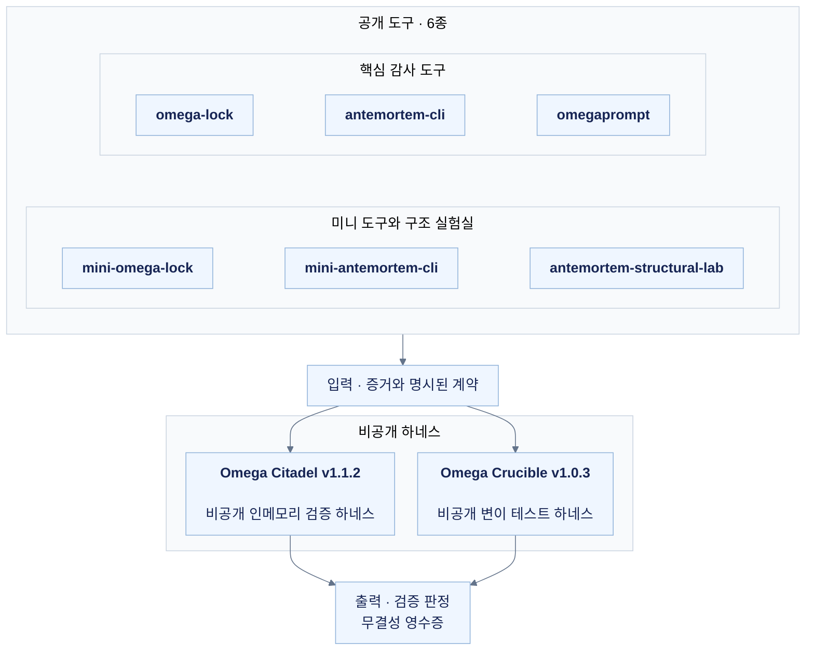

[English](./README.md) | **한국어**

# AI 검증 연구

AI/ML 평가 및 소프트웨어 신뢰성 검증을 위한 비영리 개인 연구 및 오픈소스 소프트웨어 프로젝트입니다.

공개 Python 패키지 여섯 개는 코드 인용 검증, 평가자 노이즈 측정, 홀드아웃 과적합 통제 등 개별 검증 기능을 제공합니다.

[현재 6개 도구의 릴리즈·계약·무설정 재현 데모](#공개-릴리즈와-체크포인트-식별자)는 아래에 정리하며, 이전 감사 기록은 원래 버전으로 보존합니다.

이와 함께 공개 패키지에 정의된 검증 계약을 이용해 단일 프로세스 인메모리 통합 오버헤드와 합성 변이 내성을 연구하는 비공개 개인 연구 하네스 두 개를 운용합니다:

- **Omega Citadel · JEV Suite 1.1.2**는 AST 그라운딩, 통계 게이트, 홀드아웃 통제와 무결성 영수증 발행을 단일 파이프라인으로 연결합니다.
- **Omega Crucible · Red-Team Gauntlet 1.0.3**은 제한된 범위의 합성 변이와 교차 테스트를 통해 명시된 검증 API의 방어 경계를 시험합니다.

아래 수치는 각 버전과 검증 계약에 따라 실행한 결과를 보존한 스냅샷입니다. 별도로 표기한 실행 감사에서는 평가 대상 패키지 코드를 변경하지 않고 회귀 테스트, 프로토콜 전송, 변이 주입 및 실행 구조 벤치마크를 새로 측정했습니다. 공개 범위는 검증 계약의 경계, 요약 지표, 해시 식별자에 한정하며 Citadel과 Crucible의 소스 코드, wheel, 번들 및 원본 영수증은 비공개로 유지합니다.

## 저장소 접근 권한 및 라이선스 (비영리 개인 연구)

| 구분 | 대상 저장소 및 패키지 | 라이선스 | 공개 여부 |
|---|---|---|---|
| 공개 오픈소스 패키지 | `omega-lock`, `antemortem-cli`, `omegaprompt`, `mini-omega-lock`, `mini-antemortem-cli`, `antemortem-structural-lab` | `Apache-2.0` | PUBLIC |
| 비공개 연구 하네스 (비영리) | Omega Citadel; Omega Crucible | `All Rights Reserved — Personal R&D, No Redistribution` | PRIVATE |

비공개 연구 하네스는 사전 서면 승인 없는 열람, 복제, 수정, 재배포, 제3자에 대한 사용권 재부여, 사용, 역설계, 디컴파일, 디스어셈블, 프롬프트·LLM을 이용한 구조적 복제 및 파생물 생성을 허용하지 않습니다. 이 권리 고지는 저작권자의 고유 작업물에 적용되며, 별도 라이선스를 따르는 제3자 오픈소스 구성 요소는 원 라이선스 조건을 유지합니다. 공개 저장소 여섯 개의 Apache-2.0 라이선스도 유지합니다.

### 최신 비공개 연구 패치 (v1.1.2 / v1.0.3)

| 연구 하네스 | 패키지 버전 / 비공개 태그 | 현재 소스 commit | 직접 회귀 테스트 결과 |
|---|---|---|---|
| Omega Citadel | `1.1.2` / `v1.1.2` | `331392028dbbf21c62c7eca9a25b7c950b6a7ec3` | 265 PASS / 0 FAIL / 0 ERROR / 0 SKIP |
| Omega Crucible | `1.0.3` / `v1.0.3` | `29c87a253e1d416b5711654aee7fef91ca706964` | 355 PASS / 0 FAIL / 0 ERROR / 0 SKIP |

이번 패치는 검증 알고리즘을 보존하면서 비영리 개인 연구 선언, 저작권 고지, 한영 문서 및 패키지 메타데이터를 정비한 버전입니다. 명시된 AST 정규화 기준으로 Citadel의 런타임 모듈 21개는 실행 구조가 이전 버전과 동일합니다. 포함된 구성 요소 7개(vendored Python 파일 5개와 LICENSE·NOTICE)도 바이트 단위로 일치합니다. Crucible 역시 패키지 파일 13개와 테스트 파일 9개의 실행 AST를 보존했습니다. 비교 시 문서 문자열과 명시적으로 변경한 버전·고지·CLI 설명 등의 표시 문자열을 정규화했습니다. 이는 회귀 테스트와 정규화 AST 비교에 기반한 확인이며, 임의 입력 전체에 대한 정확성이나 수학적 동치 증명을 뜻하지 않습니다.

실제 MCP 1.30.0 stdio 환경에서 `initialize`, 도구 목록 조회 및 Citadel 도구 5개 전체 호출을 통과했습니다. Crucible은 SDK와 네이티브 경로 양쪽에서 도구 6개 전체 호출을 통과했습니다. 표준 wheel, 오프라인 번들, 평문 패키지 소스를 제외한 바이트코드 런타임(locked runtime)을 각각 별도 클린 환경에서 검증했습니다. Locked 아카이브의 평문 패키지 `.py`는 0개이지만, 바이트코드 패키징 자체가 역컴파일 방지를 보장하지는 않습니다.

이번 패치는 새로운 성능 향상, 변이 일반화 또는 표본 외(OOS) 성능 개선의 근거가 아닙니다. 아래의 지연시간·변이 기록은 측정 당시의 버전, 워크로드와 근거 경계를 유지하며, 재실행한 회귀 테스트 수치(265/355)는 과거 누적 합계에 중복 합산하지 않습니다. 이전 태그, 버전별 아티팩트, 근거 해시와 실패 영수증도 보존합니다. 두 저장소는 PRIVATE 상태와 패키징 분류자 `Private :: Do Not Upload`를 유지하며 연구 판정은 `M0_HOLD / Utility & OOS NOT_ESTABLISHED`입니다.

비공개 Release의 첨부 에셋 **37/37**개를 인증하여 다시 다운로드했고 파일 전체 SHA-256이 일치했습니다. 현재 소스 blob과 태그 대상도 위 commit과 일치했으며 두 저장소는 PRIVATE를 유지했습니다. 보존된 발행 readback 영수증의 전체 파일 SHA-256은 `6bc3b5a763f2b3b2c14a71ff7036481b499bc3905ca56168a3ef02d4b04ced71`입니다.

#### 현재 패치 아티팩트 해시 (v1.1.2 / v1.0.3)

신규 비공개 패치 파일 전체의 SHA-256 목록입니다. 실제 배포물, 바이트코드 아카이브와 근거 파일은 비공개로 보관하며 아래 해시는 권한 보유자의 무결성 대조용 식별자입니다. 각 체크섬 매니페스트 자체의 전체 파일 해시는 내부에 열거된 항목의 해시와 구분합니다.

| 신규 비공개 패치 아티팩트 | SHA-256 |
|---|---|
| `Citadel 1.1.2 / bundle-build.json` | `43b3aa8f5cbe546d611e6f1e943f9531305e5c5df660ad79c5ae76fbd15406ef` |
| `Citadel 1.1.2 / BUNDLE_VERIFICATION_v1.1.2.json` | `8dfab062565b65efe9671ae788a2fbe00470e9ac56c37e90e571f307aa8f5714` |
| `Citadel 1.1.2 / CHANGELOG.md` | `0be4721f83cb826dce053387a34dafec1a02f31ca791b4c49425915a10cff13f` |
| `Citadel 1.1.2 / COMPLIANCE_VERIFICATION_v1.1.2.json` | `fbc998bddac3c1695bdba7cf7e0ee4d121da37d553d42f72833cba405ef8651d` |
| `Citadel 1.1.2 / KEYWORD_SCAN_v1.1.2.json` | `cd2724d32b1a4e77ee6189d08b917f12b4194dde81c6605136f6d535a37cb0d7` |
| `Citadel 1.1.2 / LICENSE` | `bfdb27a203147789fcfac11a444c2bc8908e9f002291c51ed26b9dc1af229895` |
| `Citadel 1.1.2 / NOTICE` | `e1569cedab4c0e22fb6a4497713d484d54ba1ecbbb7dbff73dfdc7d230e536cf` |
| `Citadel 1.1.2 / omega-citadel-1.1.2-locked-runtime.zip` | `2604f342a2d375a4fd643cd510853524a534587a750d127edf8431f52849174f` |
| `Citadel 1.1.2 / omega-citadel-1.1.2-validation-evidence.zip` | `f3390e9b4e961e5e21520ee3af1b790768625aebb8e800bc946f435f1269b42f` |
| `Citadel 1.1.2 / omega-citadel-1.1.2-windows-py312.zip` | `2aa49da5c4ccac77f2fc1c0611d5f9e531ce2766dd62a5c8ed74434e34113811` |
| `Citadel 1.1.2 / omega_citadel-1.1.2-py3-none-any.whl` | `79e59e88f69d0f976ff48be42a0a0417c20f2aac95a41d9a075c2d3825a0b8fb` |
| `Citadel 1.1.2 / omega_citadel-1.1.2.tar.gz` | `fbf374e0ea9f8888bc00c64bf57fb13062ee57908df68150c7a2ccddc4ac45bc` |
| `Citadel 1.1.2 / pyproject.toml` | `3963b6d861eb462dbb2aaa330edc64198e7094e75bbbc65afb4e0c11817f15af` |
| `Citadel 1.1.2 / pytest-v1.1.2.log` | `2bbc04ec7c3790cce314c87e3dbcbdceff95ce4d5c540784aa64dd67406e11e3` |
| `Citadel 1.1.2 / pytest-v1.1.2.xml` | `86ac6809f6a882879538e0ca9c5888469ebf6e92bf9c6b817a24088f7f5f0b9b` |
| `Citadel 1.1.2 / README.ko.md` | `a798d0769b627339cc28776327c815e2c8f563ddb4f2bcd8dfb7fd8172475131` |
| `Citadel 1.1.2 / README.md` | `3442fdfacf0917b2b51c89283ff626f84888fd1c2e3bae9a0530a7d3ffa61eaa` |
| `Citadel 1.1.2 / RUNTIME_LOGIC_PRESERVATION.json` | `90940b4001544027dd6a9e7b46df70cb1ceb1c00fb2867f6bd32054be64cff2c` |
| `Citadel 1.1.2 / SHA256SUMS.json` | `1ca01d415720ac119d4619e872fbe8cfbb30baa5f1454fa378e50fd573b35f3c` |
| `Citadel 1.1.2 / SOURCE_BASELINE.json` | `90acba7ca68e76c65e37f73cc05c6f583fbd2a8290338c26bfc6afbd8c62766a` |
| `Crucible 1.0.3 / ARTIFACT_KEYWORD_SCAN.json` | `688f8aba6347fb4ed3e92178f6db95096752d33be4da1c41f9286e419fed14ea` |
| `Crucible 1.0.3 / BEHAVIOR_PRESERVATION.json` | `0478302a56cfb241f49896ebd7e84ecd3db966792214a5b88b4a7c04db6aba1c` |
| `Crucible 1.0.3 / CLEAN_WHEEL_VERIFICATION.json` | `9e545aa44c2737db78d91493f887fdd6e5569922422664a6b2745d43e53bf556` |
| `Crucible 1.0.3 / COMPLIANCE_VERIFICATION.json` | `1b99d47e0cb02efc96485823dfb876351c04c12eb21407dc8cc9b2371c31670e` |
| `Crucible 1.0.3 / KEYWORD_SCAN.json` | `a49cc245b1d00c41c080d2ac83259afda5669bdaa1beb4aa33e78bec926dca31` |
| `Crucible 1.0.3 / LICENSE` | `4cc2fd1d3235a694bd2d4e220e38cb148fde5c864020d0398e3a6482d93b6892` |
| `Crucible 1.0.3 / LOCKED_RUNTIME_VERIFICATION.json` | `aeb1f11f6ee802ab36f8bfd7ad45f273f5101d265f7dba5af7031583407ddbab` |
| `Crucible 1.0.3 / MCP_130_VERIFICATION.json` | `4ad4035121015a7891a312fe4e136ebdae28297bfa8ad45a538af617539e6f88` |
| `Crucible 1.0.3 / OFFLINE_INSTALL_VERIFICATION.json` | `639513a8848c63d443f6b2c77865264bb06c246992a7cf91af120cf5f5d378a1` |
| `Crucible 1.0.3 / omega-crucible-1.0.3-locked-runtime.zip` | `1f5282884bd2316e5cfa4a8733ed417d395c5ea71c60fc20ab70fec735b7cc34` |
| `Crucible 1.0.3 / omega-crucible-1.0.3-validation-evidence.zip` | `4f1ccd053c061c849c0177bc6a6a1cbc440a11489920da6c4e07106b7fd85be6` |
| `Crucible 1.0.3 / omega-crucible-1.0.3-windows-py312.zip` | `ffe45c5dca3ae810376db787731ebd0e7c747a297bca434a7a7b978d3ba49390` |
| `Crucible 1.0.3 / omega_crucible-1.0.3-py3-none-any.whl` | `9b159fe454f591a0a5459a7c48a30570ebe4b2a2f7d7c1ca52090a0b9345bc82` |
| `Crucible 1.0.3 / pytest-v1.0.3.xml` | `17b247b2caff69190c1c78689fdcb0b13420d7847b8eb4bf84a75f2e78c50757` |
| `Crucible 1.0.3 / README.ko.md` | `22297cf315ff952b78ece609588edb33d98506b19320c1208d29fab0c24977eb` |
| `Crucible 1.0.3 / README.md` | `44153f2012d51d0fafef31d20a1e2079a3784f2f69a3dba2b4e3fe6482d0fea3` |
| `Crucible 1.0.3 / SHA256SUMS.json` | `87a0a9e7c02add535182fd785dd32851a12a3d761f63c412ede319ca4b10887b` |

### 보존된 이전 패키징 스냅샷 (v1.1.1 / v1.0.2)

아래는 라이선스·문서 정비 이전의 패키징 스냅샷입니다. 기존 테스트 코퍼스, 벤치마크, 정상 대조군과 연구 판정은 원래 버전과 근거 경계를 유지합니다.

| 연구 하네스 | 패키지 버전 | 평가 대상 릴리즈 코드 스냅샷 | Pytest 결과 |
|---|---|---|---|
| Omega Citadel | `1.1.1` | `794ba06813cde28f95107013c320c1850052afa9` | 265 PASS / 0 FAIL / 0 ERROR / 0 SKIP |
| Omega Crucible | `1.0.2` | `aab3fb1d95ce8efc0a2be4f254895d09d3793fb6` | 355 PASS / 0 FAIL / 0 ERROR / 0 SKIP |

| 보존된 비공개 아티팩트 | SHA-256 |
|---|---|
| `omega-crucible / omega_crucible-1.0.2-py3-none-any.whl` | `2d84f08bb236c2b1ea9bb3373bee4c7a67b820312b4493f6f526a32870edbf74` |
| `omega-crucible / omega-crucible-1.0.2-windows-py312.zip` | `6c631498aa7bf598f84ef3260f96cf3bfb9a9365f7581f25bf944b72921282b8` |
| `omega-crucible / omega-crucible-1.0.2-locked-runtime.zip` | `fb19ca7ad88d9223a47028035403980640c4e11add9afa30f21a1073a13cacdc` |
| `omega-crucible / verification-report-v1.0.2.json` | `710e517fdca5f9d9f57e21f40a4e3986ac791bb4fbbe267ae5c84b8544489b99` |
| `omega-crucible / OMEGA_CRUCIBLE_REPORT_v1.0.2.html` | `e89eed995c26f99b447fb6490023e27411b9c88cd8a5ed2f6ec2cc671fdc1c07` |
| `omega-crucible / CrucibleGauntletReceipt-v1.0.2.json` | `57266581d55d852b7ef4877bc7c3aaca74e2479f4240f9bec29967e43d3dbccc` |
| `omega-crucible / installer-verification-v1.0.2.json` | `b119640273fbdf142d66ca518add5af314831f222f6049404a29bad84d87355f` |
| `omega-crucible / release-assets-v1.0.2.json` | `3bdeae3498b09eef131b92ac380b6a4ca2f19405a1343c7d68a00a7d8472ccd3` |
| `omega-crucible / FINAL_SHA256SUMS_v1.0.2.txt` | `8cf5a94b19f7a3bb61c6fb2dde1b219aaee8575e5d256bfc9bf27553053a309e` |
| `omega-crucible / omega-crucible-1.0.2-validation-evidence.zip` | `5c91e59a90bdb00ae6d46e85386f76d5d596c88dc00e2c121fee1cdba6ea8a37` |
| `omega-citadel / omega_citadel-1.1.1-py3-none-any.whl` | `73dc391af4d61dd652f0ee37f1e7822bb8b6a22157e98b60cf7d4f4242cfdf91` |
| `omega-citadel / omega-citadel-1.1.1-windows-py312.zip` | `048b515061de399c0c430cfbbba4a4001a6b14bc3977df9a465540a08b169d2c` |
| `omega-citadel / omega-citadel-1.1.1-locked-runtime.zip` | `3e1244c945e74a7bd1ecfd96972ff449c841105efcd5f704f48e805670d3727d` |
| `omega-citadel / LICENSE_README_VERIFICATION.json` | `56097877382f1966c9c01a4a1506b64be61e6e5450132b3d01df97ae866de473` |
| `omega-citadel / OMEGA_CITADEL_V111_REPORT_KO.html` | `d1a3b3eb5f836f31074c32dc8a522a2603a489b494a528f37e42c9ece29efec1` |
| `omega-citadel / SHA256SUMS.json` | `297f12b410a3e91d089bb6d98b844daf6b549da4322dfbed89bb6daaf6e5d286` |
| `omega-citadel / omega-citadel-1.1.1-validation-evidence.zip` | `4283822c148c9cd50470a17dc8b4e0c634a77d77e2030a53ee4a9c9ccd2edd60` |

두 소스 저장소와 Release 에셋은 비공개입니다. 해시 공개는 파일을 공개한다는 뜻이 아니며, 패키징 정비는 연구 효용, OOS 일반화 또는 법적 복제 금지 조항의 실효성을 입증하지 않습니다. 연구 판정은 `M0_HOLD / NOT_ESTABLISHED`를 유지합니다.

## 실행 감사 기록 (2026-11-02)

이 감사는 Citadel **1.1.1** 코드 스냅샷 `794ba06813cde28f95107013c320c1850052afa9`와 Crucible **1.0.2** 코드 스냅샷 `aab3fb1d95ce8efc0a2be4f254895d09d3793fb6`를 기준으로 수행했습니다. 문서 갱신 커밋과 감사 에셋은 런타임 평가 커밋과 구분합니다. 기존 태그와 에셋을 유지하며 과거 1.1.0/1.0.1 릴리즈를 재발행하지 않았습니다.

| 비공개 저장소 | 보존된 문서 commit / `audit-20261102` 태그 | 평가 대상 런타임 릴리즈 commit |
|---|---|---|
| Omega Citadel | `a380e6cd3c75d0217d41b24fb46e5769b64d9b87` | `794ba06813cde28f95107013c320c1850052afa9` |
| Omega Crucible | `a5eb868b82d9be2170eab72c1279b6936a4da0e0` | `aab3fb1d95ce8efc0a2be4f254895d09d3793fb6` |

위 문서 커밋은 당시의 소스 라이선스, 한영 README와 감사 요약만 갱신했습니다. 해당 감사에서 런타임 Python 파일과 패키지 버전은 변경하지 않았습니다. 소스 라이선스의 저작권 문구는 `Copyright (c) 2026 Kyunghoon Gwak (hibou04-ops). All Rights Reserved.`이며, 보존된 릴리즈 아카이브도 다시 작성하지 않았습니다.

| 검증 항목 | 관측 결과 | 검증 범위 및 비고 |
|---|---|---|
| Citadel 1.1.1 pytest | 265 PASS / 0 FAIL / 0 ERROR / 0 SKIP | 신규 직접 회귀 실행; 과거 누적 PASS 합계에 다시 더하지 않음 |
| Crucible 1.0.2 pytest | 355 PASS / 0 FAIL / 0 ERROR / 0 SKIP | 신규 직접 회귀 실행; 과거 누적 PASS 합계에 다시 더하지 않음 |
| 실제 MCP 1.30.0 stdio | Citadel: initialize, 도구 5개 목록·전부 호출; Crucible: SDK·native 양쪽에서 initialize, 도구 6개 목록·전부 호출 | 실제 MCP 요청·응답 왕복; SDK 2.x 모의 계약과 별개; MCP 지연시간 주장은 없음 |
| 외부 파이프라인 교차 검증, 고정 공격 1,067건 | 원본 판정: 차단 1,008, 생존 1, 입력 거절 58, 오류 0; 정상 대조군 90/90 통과 | 동결 어댑터 투영: 차단 918, 미지원 91, 입력 거절 58; 미지원 입력을 지원으로 확립하지 않음 |
| 복합 공격 검증 | 7/7 방지: 판정 차단 3, 입력 거절 4; 정상 대조군 1/1 통과 | 입력 거절은 의미적 변이 차단이 아님 |
| 네이티브 영수증 readback 브리지 | 무결성 거절 512/512; 정상 대조군 2/2 통과 | 파이프라인 판정과 별도 계약 |
| 소스 동결 후 시드 D | 정상 대조군 64/64 통과; 공격 544: 판정 차단 528, 입력 거절 16, 생존 0, 오류 0 | 같은 세션·동일 생성기·명세의 무작위 평가; 독립 외부 OOS가 아님 |
| 시드 D 한계 탐색 probe | 32/32 생존: 자체 재해시 영수증 16, 미정의 JSON 구조 16 | 공격 544건의 분모와 별도 |
| Crucible 바이트코드 런타임 (locked runtime) | 패키지 `.pyc` 13개, 평문 패키지 `.py` 0개, 매니페스트 17항목; 클린 환경 CLI·영수증 readback·native MCP 도구 6개 호출 통과 | CPython 3.12 런타임; 소스 생략은 역컴파일 방지를 보장하지 않음 |
| Stage 5 보존 아티팩트 재확인 | 2,160 PASS / 0 FAIL / 0 ERROR / 5 SKIP | 보존된 원본 JUnit·로그·closure 재파싱; 공개 패키지 새 테스트 실행이 아님 |
| Structural Lab v8 로컬 아카이브 재확인 | 1,561 PASS / 0 FAIL / 0 ERROR / 1 SKIP; 내부 SHA-256 검사 2,345건, 불일치 0 | 보존된 JUnit과 로컬 아카이브; 실시간 Drive 정본은 재검사하지 않음 |

외부 테스트 코퍼스에서 원본 판정 기준으로 생존한 1건은 동결 어댑터의 미지원 범주에 속합니다. 방어기에 전달한 페이로드에는 정답 라벨(oracle role·family·기대 판정·case label)이 없음을 확인했습니다. 이 검사는 전달된 페이로드에 한정되며, 알려진 생성기나 개발 코퍼스까지 미노출이었다는 증거는 아닙니다.

시드 C 최초 실행에서는 editable 설치의 `.pth` 초기화가 누락되어, 배포 메타데이터는 조회되지만 패키지를 import할 수 없는 환경에서 **640 ERROR**가 발생했습니다. 이 실패 원본을 보존했습니다. 이후 방어기 소스는 변경하지 않고 실행 환경을 복구한 뒤 새 시드 D를 사전 고정하여 같은 동결 소스·생성기에 평가했습니다. D의 결과는 C의 실패를 지우거나 독립 OOS 일반화를 입증하지 않습니다. 앞선 테스트 환경 실패와 하네스 경로 실패도 비공개 감사 영수증에 보존합니다.

### 실행 구조 벤치마크 (2026-11-02)

Windows x64 / CPython 3.12.10 환경에서 고정 페이로드로 **20회 교대 쌍 실행**했으며, 게이트 판정 출력은 **20/20**쌍에서 동일했습니다.

| 측정 항목 | 5단계 서브프로세스 하네스 (Cold) | 단일 프로세스 인메모리 파이프라인 (Warm) |
|---|---:|---:|
| 중앙 지연시간 | 1,229.61405 ms | 19.3654 ms |
| 반복당 프로세스 생성 횟수 | 5 | 0 |
| 반복당 공통 파일 AST 파싱 횟수 | 5 | 1 |

중앙값 기준 지연시간 비율은 **63.50×**이며 영수증 readback 불일치는 0건입니다. 단일 머신의 실행 구조를 비교한 결과로, 버전 간 속도 비교나 공개 패키지 다섯 개의 실제 CLI 성능 비교가 아닙니다. 통합 경로는 warm import 상태에서 입력 스냅샷·영수증 발행·readback을 포함하므로 두 경로의 시작 조건이 다릅니다. 동일한 vendored 워크로드를 유지하기 위해 양쪽의 선택적 교차 검증(federated crosscheck)은 비활성화했습니다. 모델 품질, 연구 효용, 다른 워크로드 또는 OOS 성능 개선은 입증하지 않습니다.

### 보존된 감사 근거 해시 (2026-11-02)

보존된 비공개 감사 근거 파일 전체의 SHA-256입니다. 파일을 공개하거나 아래의 과거 해시를 대체한다는 뜻은 아닙니다.

| 보존된 감사 아티팩트 | SHA-256 |
|---|---|
| `Citadel fresh pytest XML` | `33774bfb10b73beda8fa8fd817c8d58657a0a47679587d4e5f908e6277c50713` |
| `Citadel fresh 20-run benchmark report` | `95b5bdb79a97029d0d74ef5a3e59b6a17914fa821a461c7c9f589515e952d157` |
| `Citadel seed C environment-failure report` | `e852dc8ef1df1823ef16d55db56cb14c8ba290ef58f07cfc7486d8bf99c05518` |
| `Citadel seed D randomized evaluation report` | `c72d22cf125d13357485a0e8e16306cb29a3c4854924810d4f6a8ccf43514ee1` |
| `Crucible fresh cross-suite and native verification` | `6deda0a1ac32feff0f64a810f43c4b9bcb89168fc73a58222eb930c90fe22690` |
| `Crucible actual MCP 1.30.0 stdio report` | `037e01c48c42199ff7642ecf45da8c5b23da0dba61270dc3213492570019bf53` |
| `Crucible new locked-runtime verification report` | `c42d40eae66d2a2b240626d01293ab28152841b5932cc8ed61ae6a608ce24842` |
| `Crucible new audit evidence ZIP` | `30caa0094a555ec20df237dc2d9074550329f2e7c8920f7bc10eb1f92bc43e73` |
| `Stage 5 preserved-artifact current readback` | `1775fd12606e8a2e7963686cd18c0b0b2ed5a759c538fb9f2c76a5d3b72490ef` |
| `Structural Lab v8 local-archive current readback` | `161b2999eab0b8f59b179affe2c2cf84f8b2c10a352c60646f17d30f651a8223` |

패키지 회귀, 소스·아티팩트 무결성, 제한된 변이 테스트 결과는 서로 구분합니다. 연구 판정은 **`M0_HOLD / Utility & OOS NOT_ESTABLISHED`**입니다.

## 아키텍처 구조 및 계약 경계



| 경계 | 공개 계약 |
|---|---|
| 입력 | 제공된 근거와 명시된 검증 계약 |
| 비공개 검증 하네스 | 내부 구현, 의존성과 실행 순서는 공개하지 않음 |
| 출력 | 명시된 계약 범위의 판정과 무결성 영수증; readback으로 무결성 확인 |

AST 귀속 검증은 자연어 주장이 참이라는 증명이 아니며, 전체 처리의 `O(N)` 성능 보장도 하지 않습니다. 통계 게이트는 제공된 표본과 홀드아웃 주장을 검사하며 독립 실험을 대신하지 않습니다.

## 버전별 검증 장부

**보존된 누적 PASS 스냅샷: 4,341 = 2,160 + 1,561 + 265 + 355.** 서로 다른 실행 기록의 합계이며 고유 테스트 수, 독립 사례 수 또는 동일 환경의 단일 실행 결과를 뜻하지 않습니다.

| 장부 | 보존 결과 | 근거 범위 |
|---|---:|---|
| 공개 도구 다섯 개 · Stage 5 | 2,160 PASS / 0 FAIL / 0 ERROR / 5 SKIP | 검증된 Stage 5 아티팩트: 627 + 592 + 616 + 157 + 168 |
| Structural Lab v8 | 1,561 PASS / 0 FAIL / 1 SKIP | 보존 원본 기록; 건너뛴 사례는 PASS 합계에서 제외 |
| Citadel 1.1.0 | 265 PASS / 0 FAIL / 0 ERROR / 0 SKIP | 보존된 직접 pytest 실행; 외부 변이 결과와 별도 |
| Crucible 1.0.1 | 355 PASS / 0 FAIL / 0 ERROR / 0 SKIP | 보존된 직접 pytest 실행; 외부 변이 결과와 별도 |

이전 **3,951** 스냅샷은 2,160 + 1,561 + 230, **4,306** 스냅샷은 2,160 + 1,561 + 230 + 355입니다. 1.1.0 검증 스냅샷에서는 Citadel 1.0.1의 230을 1.1.0 기록으로 대체했습니다. Crucible 1.0.0의 과거 **316** PASS 기록은 다시 더하지 않았으며, 장부 사이 테스트 중복 여부는 독립적으로 확인되지 않았습니다.

### Stage 5 아티팩트와 별도 공개 CI 관측

2,160 PASS의 근거 등급은 `VERIFIED_STAGE5_ARTIFACTS`입니다. 읽기 전용 대조에서 **2026-11-01 23:10 KST** 마감 원장, `release-closure.json`, 원본 JUnit 다섯 개와 pytest 로그 다섯 개의 기록이 일치했습니다. 원본 2,165개 테스트의 결과는 2,160 PASS, 0 FAIL, 0 ERROR, 5 SKIP이며 pytest, consistency, build, twine, release-audit의 종료 코드 25개는 모두 0입니다.

| Stage 5 원본 아티팩트 | SHA-256 |
|---|---|
| `release-closure.json` | `7d200dbbbab8b564e3107bf83e5f81134f6a6ca534bfca8974f4a0bc98f95af6` |

Stage 5의 공개 릴리즈 다섯 개는 PUBLISHED로 기록되어 있으며 원격 태그의 commit SHA를 아래 고정 스냅샷과 대조했습니다. SKIP은 omega-lock 3, antemortem-cli 1, omegaprompt 1이며 두 미니 도구는 각각 0입니다.

별도로 확인한 **Ubuntu / Python 3.11의 선택된 full-pytest job**은 실행 범위가 다릅니다.

| 공개 도구 | 관측 PASS | SKIP | 공개 CI 근거 |
|---|---:|---:|---|
| omega-lock | 603 | 27 | [선택된 job](https://github.com/hibou04-ops/omega-lock/actions/runs/41314509683/job/124871603846) |
| antemortem-cli | 593 | 0 | [선택된 job](https://github.com/hibou04-ops/antemortem-cli/actions/runs/41314507040/job/124871596243) |
| omegaprompt | 616 | 0 | [선택된 job](https://github.com/hibou04-ops/omegaprompt/actions/runs/41314509295/job/124871603311) |
| mini-omega-lock | 157 | 0 | [선택된 job](https://github.com/hibou04-ops/mini-omega-lock/actions/runs/41314509674/job/124871604022) |
| mini-antemortem-cli | 168 | 0 | [선택된 job](https://github.com/hibou04-ops/mini-antemortem-cli/actions/runs/41314509819/job/124871604481) |
| 선택된 job 합계 | **2,137** | **27** | 다른 matrix job과 후속 demo 제외 |

omega-lock은 로그에 명시된 요약을 사용했고, 나머지는 성공한 job의 완료 로그에서 통과 표시를 집계했습니다. 이 공개 CI 관측은 Stage 5 로컬 아티팩트의 2,160 PASS / 5 SKIP을 대체하지 않습니다. 보존된 v8·Citadel 장부와도 구분합니다.

## 공개 릴리즈와 체크포인트 식별자

### 현재 공개 릴리즈와 Fail-Closed 계약

2026-11-02 (KST)에 GitHub Latest Release, 태그에 고정한 `pyproject.toml`, 현재 `main` Actions를 직접 대조했습니다. 아래 패키지 버전은 소스 메타데이터이며 모든 버전의 PyPI 게시를 뜻하지 않습니다. CI 링크는 확인한 `main` commit을 식별하며, Release 태그 이후 CI·이식성 후속 수정이 있을 수 있습니다. 아래 과거 표는 원래 버전별 집계로 보존합니다.

| 공개 도구 | 최신 GitHub Release | 패키지 메타데이터 | 현재 main CI | 아키텍처 계약 |
|---|---|---|---|---|
| [antemortem-cli](https://github.com/hibou04-ops/antemortem-cli) | [v0.12.2](https://github.com/hibou04-ops/antemortem-cli/releases/tag/v0.12.2) | [0.12.2](https://github.com/hibou04-ops/antemortem-cli/blob/edcb7407b25c89ac21104d1153d9a2caeb8677a8/pyproject.toml) | [SUCCESS](https://github.com/hibou04-ops/antemortem-cli/actions/runs/41442433021) · [main `9a03f03`](https://github.com/hibou04-ops/antemortem-cli/tree/9a03f03f14d3b87d8ca9caad3bd09832ce621211) | AI 코드 인용의 `file:line` 근거와 선택적 SHA-256 바인딩을 검증하는 결정론적 검증기 및 CI 게이트입니다. `fabrication_rate`와 전체 주장 대비 `effective_coverage` (`verified / total`)를 동시 강제합니다. `gate`는 schema를 통과한 분류와 현재 디스크 근거에서 지표를 재계산하고 `compute_decision()`을 호출해 저장 판정과 재계산 판정의 불일치를 검사하여, `UNRESOLVED` 분모 회피와 재계산 결과에 맞지 않는 저장 승인을 차단합니다. [소스 계약](https://github.com/hibou04-ops/antemortem-cli/blob/edcb7407b25c89ac21104d1153d9a2caeb8677a8/src/antemortem/commands/gate.py#L132). |
| [omega-lock](https://github.com/hibou04-ops/omega-lock) | [v0.3.11](https://github.com/hibou04-ops/omega-lock/releases/tag/v0.3.11) | [0.3.11](https://github.com/hibou04-ops/omega-lock/blob/a356e3e910271ccf5ff8596822c7147711fec65c/pyproject.toml) | [SUCCESS](https://github.com/hibou04-ops/omega-lock/actions/runs/41447799318) · [main `443e56a`](https://github.com/hibou04-ops/omega-lock/tree/443e56af7cc8893680fa0582195b4ca8332a4752) | Optuna 및 ML 파이프라인용 Fail-Closed Hold-out 감사 도구입니다. Hold-out 생략(`SKIP`, `holdout_evaluated=False`) 시 호환용 `passed=True`를 유지해도 `deployment_authorized=False`를 강제합니다. 평가한 Hold-out에는 Pearson 선형 상관계수, 학습 점수 대비 상대 하한과 위치 이동 방어(`degradation_gap`, 설정 가능한 `max_degradation_gap`)를 결합합니다. 별도 `compute_deflated_threshold()` helper는 호출자가 제공한 노이즈 하한과 시도 횟수로 기준 임계값을 가산 조정하며, 이 Hold-out 게이트가 자동 적용하지는 않습니다. [소스 계약](https://github.com/hibou04-ops/omega-lock/blob/a356e3e910271ccf5ff8596822c7147711fec65c/src/omega_lock/integrations/optuna_bridge.py#L226). |
| [omegaprompt](https://github.com/hibou04-ops/omegaprompt) | [v2.2.4](https://github.com/hibou04-ops/omegaprompt/releases/tag/v2.2.4) | [2.2.4](https://github.com/hibou04-ops/omegaprompt/blob/55caf1027573c73f1b47f963613c6b0a764cc740/pyproject.toml) | [SUCCESS](https://github.com/hibou04-ops/omegaprompt/actions/runs/41438314910) · [main `55caf10`](https://github.com/hibou04-ops/omegaprompt/tree/55caf1027573c73f1b47f963613c6b0a764cc740) | 공급자 중립 LLM 평가 및 프롬프트 보정 엔진으로, 사전검사와 Hold-out의 경계를 명시합니다. `verify_calibration_preflight()`는 제공된 정적·노이즈 입력이 통과하면 `PREFLIGHT_VALIDATED`를 반환하지만, 모든 결과는 `holdout_verified=False`와 `deployment_authorized=False`를 유지합니다. 이 국소 검사는 독립 OOS Hold-out 검증을 실행하거나 일반화 성립을 입증하지 않습니다. [소스 계약](https://github.com/hibou04-ops/omegaprompt/blob/55caf1027573c73f1b47f963613c6b0a764cc740/src/omegaprompt/runtime.py#L71). |
| [mini-antemortem-cli](https://github.com/hibou04-ops/mini-antemortem-cli) | [v0.11.2](https://github.com/hibou04-ops/mini-antemortem-cli/releases/tag/v0.11.2) | [0.11.2](https://github.com/hibou04-ops/mini-antemortem-cli/blob/36fba5a0a17daf2b60aeedb44374989c36b06f3d/pyproject.toml) | [SUCCESS](https://github.com/hibou04-ops/mini-antemortem-cli/actions/runs/41442403029) · [main `22a74d5`](https://github.com/hibou04-ops/mini-antemortem-cli/tree/22a74d57bf39e3fbb8ea07b5511a76f8f80a3b59) | LLM 평가 설정용 경량 독립형 정적 사전검사기로, train/test ID 중복, few-shot 누출, 죽은 rubric 가중치 등 11개 위험 규칙을 제공합니다. 의존성 역전(DIP)으로 `omegaprompt` 필수 설치를 제거했습니다. 직접 필수 런타임 의존성은 Pydantic뿐이며, `omegaprompt` 연동은 `[bridge]` 선택 extra로 제공합니다. [소스 계약](https://github.com/hibou04-ops/mini-antemortem-cli/blob/36fba5a0a17daf2b60aeedb44374989c36b06f3d/pyproject.toml#L38). |
| [mini-omega-lock](https://github.com/hibou04-ops/mini-omega-lock) | [v0.8.3](https://github.com/hibou04-ops/mini-omega-lock/releases/tag/v0.8.3) | [0.8.3](https://github.com/hibou04-ops/mini-omega-lock/blob/9d5339b5a1efe5ca5febb4175f36d914b709456d/pyproject.toml) | [SUCCESS](https://github.com/hibou04-ops/mini-omega-lock/actions/runs/41442412367) · [main `f7ed85e`](https://github.com/hibou04-ops/mini-omega-lock/tree/f7ed85e3eb9af973fc69c9005e92d74161698661) | 평가 전 측정 신뢰성을 분석하는 경량 독립형 도구입니다. `compute_empirical_noise_ceiling()`의 기본 수식은 `mean(abs(delta)) + 1.96 * pstdev(abs(delta)) / sqrt(n)`이며 `pstdev`의 분모는 `n`입니다. `compute_minimum_detectable_effect()`는 같은 callable을 가리키는 호환 별칭으로, 검정력 기반 MDE 계산이 아닙니다. 직접 필수 런타임 의존성은 Pydantic뿐이며 `omegaprompt`는 `[bridge]` 선택 extra입니다. [소스 계약](https://github.com/hibou04-ops/mini-omega-lock/blob/9d5339b5a1efe5ca5febb4175f36d914b709456d/src/mini_omega_lock/probes.py#L482). |
| [antemortem-structural-lab](https://github.com/hibou04-ops/antemortem-structural-lab) | [v0.8.1](https://github.com/hibou04-ops/antemortem-structural-lab/releases/tag/v0.8.1) | [0.8.1a1](https://github.com/hibou04-ops/antemortem-structural-lab/blob/1b55bbe24e50c5d20b4e4f4fc42abc57f6df9fd4/pyproject.toml) | [SUCCESS](https://github.com/hibou04-ops/antemortem-structural-lab/actions/runs/41442446742) · [main `bedd0eb`](https://github.com/hibou04-ops/antemortem-structural-lab/tree/bedd0eb7e7783b369485f7c91418132d61e0f4a9) | 계약·Oracle 기반 반례 탐색 연구 시스템으로, property-based shrinking과 실제 호출을 계량하는 C/D 혼합 탐색을 결합합니다. `epsilon_static_floor=0.50`으로 정적 정책 C의 용량을 예약합니다. 양쪽 arm의 실제 호출 워밍업 뒤, 미해결 불확실성이 없는 phenotype 비교에서 D만 확인한 phenotype이 없고 D 발견율이 C보다 엄격히 낮으면 `circuit_breaker_triggered=True`로 잔여 D 용량을 C로 회수할 수 있습니다. D의 미해결 근거는 `UNKNOWN`으로 유지합니다. 연구 원장 `M0 HOLD` (`M0_HOLD`) 및 효용·외부 OOS `NOT_ESTABLISHED`는 엔지니어링 회귀 결과와 구분합니다. [소스 계약](https://github.com/hibou04-ops/antemortem-structural-lab/blob/1b55bbe24e50c5d20b4e4f4fc42abc57f6df9fd4/tomolab/discovery/recursive_policy.py#L68). |

Structural Lab의 `v0.8.1`은 연구 원장 Release이며, `0.8.1a1`은 별도로 관리하는 alpha 패키지 메타데이터입니다. 정적 하한은 명목 용량 예약으로, 조기 종료 뒤에도 예산을 강제 소진한다는 뜻이 아닙니다. 브레이커는 D에 PASS 관측만 있고 C에 확인된 실패가 있는 보수적 하한 분기도 지원합니다. 이 스케줄러와 CI 통과는 연구·OOS 판정을 승격하지 않습니다.

### API 키 없이 30초 실패 재현 (Zero-API-Key 30-Second Reproducers)

각 명령은 해당 저장소의 소스 checkout에서 선언된 의존성을 설치한 뒤 실행합니다. omega-lock에는 `[p2]` extra(Optuna)가 필요합니다. 두 데모는 오프라인으로 동작하며 API 키나 모델 서비스가 필요 없습니다. 30초는 작은 데모 실행을 가리키며 의존성 설치 시간은 포함하지 않습니다.

- [antemortem-cli 데모](https://github.com/hibou04-ops/antemortem-cli/blob/edcb7407b25c89ac21104d1153d9a2caeb8677a8/examples/reproduce_citation_traps.py#L1): `verified=1, fabricated=0, unresolved=9` (`fabrication_rate=0.0`, `effective_coverage=0.10`), 변조된 `SAFE_TO_PROCEED` 판정과 빈 근거를 차단하고 완전한 검증 근거는 통과시킵니다. 이 스크립트는 근거·판정 함정을 재현하며 코드 해시 변조 사례를 실행하지는 않습니다.
- [omega-lock 데모](https://github.com/hibou04-ops/omega-lock/blob/a356e3e910271ccf5ff8596822c7147711fec65c/examples/reproduce_optuna_traps.py#L1): No-Holdout `SKIP`의 배포 승인을 보류하고, `TRAIN=[1,2,3]` / `TEST=[-100,-99,-98]`을 Pearson `r=1.0`이어도 차단합니다(`degradation_gap=101.0`). 점수가 일치하는 정상 Hold-out은 통과합니다.

```bash
python examples/reproduce_citation_traps.py
python examples/reproduce_optuna_traps.py
```

두 스크립트는 기대한 차단·통과 결과를 assert하며 검증이 맞으면 정상 종료합니다. `file:line`·선택적 SHA-256 인용 검증은 별도 검증기 기능이며, 자연어 주장 진실성이나 원본 진위를 입증하지 않습니다.

### 과거 공개 회귀 스냅샷

| 공개 저장소 | 공개 릴리즈 또는 체크포인트 | 고정 회귀 스냅샷 commit | PASS 스냅샷 |
|---|---|---|---:|
| [omega-lock](https://github.com/hibou04-ops/omega-lock) | [v0.3.10](https://github.com/hibou04-ops/omega-lock/releases/tag/v0.3.10) | `7e9736ad68cad4a201c39ecb14151978543c5741` | 627 |
| [antemortem-cli](https://github.com/hibou04-ops/antemortem-cli) | [v0.12.1](https://github.com/hibou04-ops/antemortem-cli/releases/tag/v0.12.1) | `8a47ad5b41e05879698ae46f84b783a8d4c0f496` | 592 |
| [omegaprompt](https://github.com/hibou04-ops/omegaprompt) | [v2.2.3](https://github.com/hibou04-ops/omegaprompt/releases/tag/v2.2.3) | `27e23788990a1ea951525a401a1cb6a880e83948` | 616 |
| [mini-omega-lock](https://github.com/hibou04-ops/mini-omega-lock) | [v0.8.2](https://github.com/hibou04-ops/mini-omega-lock/releases/tag/v0.8.2) | `e862019dcb1eedcad45a48f5c34ad7f6c09ba5ce` | 157 |
| [mini-antemortem-cli](https://github.com/hibou04-ops/mini-antemortem-cli) | [v0.11.1](https://github.com/hibou04-ops/mini-antemortem-cli/releases/tag/v0.11.1) | `5e1f0face5d4d7fdca1af8a6c6bb65451a211937` | 168 |
| [antemortem-structural-lab](https://github.com/hibou04-ops/antemortem-structural-lab) | [v0.8.0 / COMMITTED-v8](https://github.com/hibou04-ops/antemortem-structural-lab/releases/tag/v0.8.0) | `b23773c7d4cc1fb13dd7943964fdbee9afd8c7b0` | 1,561 |

Structural Lab의 공식 GitHub 릴리즈 `v0.8.0 / COMMITTED-v8`은 지정된 v8 commit을 가리킵니다. 발행 상태와 연구 판정의 승격은 별개이며 이 태그는 패키지 버전을 변경하지 않습니다. 이전 공개 패키지 릴리즈 [v0.8.0a1](https://github.com/hibou04-ops/antemortem-structural-lab/releases/tag/v0.8.0a1)은 commit `3ece4df3bd01abe6aae58ef8a01bf4b01515f689`의 별도 식별자로 보존합니다.

## Structural Lab v8 근거 경계

보존된 v8 실행의 근거 등급은 `DEVELOPMENT_SYNTHETIC_EXPOSED`이며 **독립 OOS 사례는 0건**입니다. 연구 판정은 `M0_HOLD / NOT_ESTABLISHED`를 유지합니다. 패키지 회귀 통과가 연구 효용, 일반화 또는 검증 범위 밖의 성과를 입증하지는 않습니다.

효용과 OOS 상태: `NOT_ESTABLISHED`.

- 보존된 로컬 기록: **1,561 PASS / 0 FAIL / 1 SKIP** (+32 PASS).
- 보존된 원격 기록: 네 환경 각각 **607 PASS / 0 FAIL / 0 SKIP** (+32 PASS).
- 지정 probe: **Target 192 / Oracle 192 / reset 384**, strict 1:1 reset 대칭. 외부 OCI: **0 / 0 / 0**; 자체 OCI 통제: `PASS`.
- 보존된 읽기 전용 재검증은 정본 13문서, 양쪽 영수증과 v5/v6/v7/v8 계보의 **내부 SHA-256 해시 2,345개**를 대조했으며 **불일치는 0건**입니다.

Manifest: `OA-SYNC-20261101T230122+0900-572768 — COMMITTED v8`.

SHA-256: `df34bfbe7cb192819a1d1f181df8bcfce0218fc944f808febf25c648373289cb`.

[원본 검증 보고서](https://github.com/hibou04-ops/antemortem-structural-lab/releases/tag/v0.8.0)는 공식 릴리즈에 첨부되어 있습니다.

## Citadel 1.1.0: 보존된 지연시간

**2026-11-02 Citadel 1.1.0 측정**은 Windows x64, CPython 3.12.10 환경에서 고정 하네스 페이로드로 **20회 교대 쌍 실행**한 결과입니다. 게이트 판정 출력은 20쌍 모두 동일했습니다.

| 측정 항목 | 5단계 서브프로세스 하네스 (Cold) | 단일 프로세스 인메모리 파이프라인 (Warm) |
|---|---:|---:|
| 기록된 중앙 지연시간 | 1,176.35645 ms | 15.7332 ms |
| 측정 반복당 프로세스 생성 횟수 | 5 | 0 |
| 반복당 공통 파일 AST 파싱 횟수 | 5 | 1 |

기록된 중앙값 비율은 **74.77×**였습니다. 통합 측정에는 입력 스냅샷, 영수증 발행과 readback이 포함됩니다. 단일 머신과 고정 페이로드에서 두 실행 구조를 비교한 결과이며 버전 간 속도 개선, 모델 품질, 연구 효용 또는 OOS 성과를 입증하지 않습니다. Cold 기준 경로는 공개 도구 다섯 개의 실제 CLI가 아니라 같은 게이트를 다섯 단계로 실행하는 하네스입니다. 통합 경로는 warm import 상태이므로 시작 조건이 다릅니다.

### Citadel 1.0.1: 보존된 지연시간

보존된 벤치마크는 **Windows x64, CPython 3.12.10 환경에서 고정 페이로드로 20회 교대 쌍 실행**한 결과입니다. 두 실행 구조의 게이트 판정은 20쌍 모두 동일했습니다.

| 측정 항목 | 5단계 서브프로세스 하네스 (Cold) | 단일 프로세스·인메모리 AST 인덱스 (Warm) |
|---|---:|---:|
| 중앙 지연시간 | 1,122.6 ms | 14.2 ms |
| 측정 구간의 신규 프로세스 생성 | 5 | 0 |
| 공통 파일 AST 파싱 횟수 | 5 | 1 |

**중앙 지연시간 비율은 79.1×**였습니다. 통합 측정에는 입력 snapshot, 영수증 발행과 readback이 포함됩니다.

기준 경로는 동일한 게이트를 다섯 단계로 나눈 cold 서브프로세스 하네스입니다. 공개 도구 다섯 개의 실제 CLI 성능 비교가 **아닙니다**. 통합 경로는 warm 프로세스에서 인메모리 AST 인덱싱을 사용하므로 시작 조건이 다릅니다. 수치는 해당 머신, 페이로드와 실행 구조에 한정되며 다른 워크로드의 성능, 모델 품질, 통계적 효용 또는 OOS 성과를 입증하지 않습니다. 이번 문서 편집에서 새로 측정한 결과가 아니라 보존된 측정값입니다.

## Citadel 1.1.0: 아티팩트 해시

버전 **1.1.0**, 비공개 검증 스냅샷 commit: `c22b2c95c94a3db3772aba068ec4a11b8c4621b2`.

| 비공개 아티팩트 또는 영수증 | SHA-256 |
|---|---|
| `omega_citadel-1.1.0-py3-none-any.whl` | `14508446f0edd7fcd7102edf18f29e9d017641e79340ce9dcaf66043ab7a0260` |
| `omega-citadel-1.1.0-windows-py312.zip` | `9a590291c683a841310e803015ba7c3b7e58b07319b990f1223684b4ddf4ad68` |
| `omega-citadel-1.1.0-locked-runtime.zip` | `f97040370d772633229d2b0a74dae1d6ed9ba8200275168993c37c4998c3671c` |
| `omega-citadel-1.1.0-validation-evidence.zip` | `76042d9597af914c3ff5bfe3f40d7dfa224ce8fbfc3a73e36fe997e66af05b03` |
| `OMEGA_CITADEL_V110_REPORT_KO.html` | `f64cc56135986590d81421047d1f173ce3d5db475cba527e23ccb2587a24fcff` |
| 최종 pytest XML | `971ab5566b8f48ce051b8e5a4979ea0899574e66bffcfc78564a2d2e04026a5e` |
| 20회 benchmark 보고서 전체 파일 | `ac06f886441cfcbeee92eb24798552530640f623cffe444a51c41c96e2af1a49` |
| 기존 corpus 교차 검증 보고서 전체 파일 | `e23a2441525579190b3e8fd767c9dd89dbea39fd242eb1aafdefa7baa89b7923` |
| 보존된 시드 A 보고서 전체 파일 | `54653e1dd9907f814758012c7e1e678c540ec74aaaf6468f592ebdd3f575b566` |
| 신규 시드 B 보고서 전체 파일 | `bb12459218885ea95eba1287718111544e660199c6030bcb943da03bcb57c03f` |
| 실행 소스 inventory의 canonical SHA-256 | `0bd154a6be7cac8dcff776124f397e335b6f8a64c47fdab2c655be476db912e5` |

평가한 소스, commit blob 및 표준 wheel에 포함된 소스가 바이트 단위로 일치함을 대조했습니다. 표준 wheel과 오프라인 번들은 비공개로 보관합니다. Locked runtime은 패키지의 평문 `.py`를 제외하고 CPython 3.12 바이트코드와 해시 매니페스트를 담습니다. 소스 제외는 역컴파일·독립 재구현 방지나 작성자 인증을 보장하지 않습니다. 위 해시는 실제 파일 또는 명시한 정규화 목록(canonical inventory)의 식별자이며 공개 다운로드 링크가 아닙니다.

### Citadel 1.0.1: 아티팩트 해시

버전 **1.0.1**, 비공개 검증 스냅샷 commit: `4ad4b62a22b9738973badd5f8fe538984cf1977f`.

보존된 대조 장부에는 **해시 검사 1,495건, 불일치 0건**이 기록되어 있습니다.

| 대조 방식 | 건수 | 범위 |
|---|---:|---|
| Git blob SHA-1 | 477 | 원천 파일과 Git 객체 식별자 대조 |
| SHA-256 | 1,018 | Source 477 + snapshot 89 + CI ZIP 5 + runtime 444 + binding 3 |

동일 파일의 반복 대조를 포함하므로 고유 파일 수나 독립 사례 수로 해석하지 않습니다.

| 비공개 아티팩트 또는 영수증 | SHA-256 |
|---|---|
| Wheel | `b0fcbaf0fb41a4a7f6d04c267cdf48f56d87c36a602c597817165bf937c8a40c` |
| Windows bundle ZIP | `58b720e2f210a3f63e6ea3827b698505950977bd1a24b7085ce3f46c9209f06c` |
| 20회 benchmark 영수증의 canonical digest | `8a5b18148043faf9a1c7c45dd9db9c28210b6eeb0e0e0abec27967cc4427af05` |
| 같은 benchmark 영수증 파일 전체의 digest | `60a62a62ba54214ededb4e800ed7b4fe22d78b2be98125ef2370fe86858c21df` |

정규화 본문 해시(canonical digest)는 영수증의 자체 해시 필드를 제외합니다. 따라서 파일 전체 해시와는 계산 대상 바이트가 다릅니다.

## Crucible: 자체·외부 방어기 결과

보존된 Crucible 1.0.1 실행에서 자체 방어기의 고정된 유한 테스트 코퍼스 결과는 **1,067/1,067 탐지, 변이 차단률 100.0%, 정상 대조군 90건 통과**입니다. 이 비율은 외부 방어기의 결과를 뜻하지 않습니다.

실제 외부 API에도 제한된 합성 공격을 실행했습니다. 다만 원래 테스트 코퍼스를 연결하는 파이프라인 어댑터는 원천 검증 계약의 일부만 표현합니다. 내부 구조를 해석하지 않는 불투명 아티팩트의 해시 확인은 내부 값의 의미까지 검증하지 않습니다. 자체 방어기 결과, 외부 판정, 생존, 미지원 입력과 오류는 별도로 집계합니다.

### 보존된 Citadel 1.1.0 교차 검증

보존된 최종 1.1.0 후보에 Crucible의 기존 투영 어댑터와 **공격 1,067건 / 정상 대조군 90건**을 적용했습니다. 엔진의 원본 판정과 동결 어댑터가 분류한 상호 배타적 범주를 구분합니다.

| 버전 | 공격 수 | 원본 판정 차단 | 원본 생존 | 입력 거절 | 오류 | 정상 대조군 통과 |
|---|---:|---:|---:|---:|---:|---:|
| 1.0.1 · `4ad4b62` | 1,067 | 352 | 657 | 58 | 0 | 90 / 90 |
| 1.1.0 · `c22b2c9` | 1,067 | 1,008 | 1 | 58 | 0 | 90 / 90 |

1.1.0의 동결 어댑터 분류는 **투영 판정 차단 918 + 미지원 91 + 입력 거절 58 = 1,067**입니다. 미지원 91건에서 엔진의 원본 결과는 차단 90, 생존 1입니다. 원본 판정이 차단이더라도 원래 계약의 모든 필드를 지원한다고 소급 해석할 수는 없습니다. 원본 판정의 생존이 657건에서 1건으로 줄어든 것은 개발에 노출된 코퍼스의 관측 결과이며 독립 일반화 근거가 아닙니다. 입력 거절은 의미적 변이 차단과 합산하지 않습니다.

| 재동결 후 시드 B 평가 | 건수 | 관측 결과 |
|---|---:|---|
| 정상 대조군 | 64 | 64 통과, 오탐 0 |
| 유효한 스키마 내 의미 모순 | 368 | 판정 차단 368 |
| 스키마·타입·유한값·개수 형식 위반 | 176 | 판정 차단 160, 입력 거절 16 |
| 공격 합계 | 544 | 판정 차단 528, 입력 거절 16, 원문 생존·오류 0 |
| 자체 재해시 영수증 probe | 16 | 생존 16 |
| 미정의 JSON 구조 probe | 16 | 생존 16 |

한계 탐색 probe 32건은 공격 544건의 분모와 구분합니다. 자체 재해시로 정합성을 맞춘 키 없는 영수증에는 독립적으로 신뢰할 작성자 인증 기준이 없으며, 미정의 JSON 구조도 불투명한 상태로 남습니다. 이 생존 결과를 방어 한계로 보존합니다.

**실패한 후보의 원본 기록도 보존합니다.** 후보 A는 **기존 정상 대조군 42/90**, 첫 무작위 시드 A는 **정상 대조군 60/64**만 통과하여 둘 다 오탐 0건 기준을 충족하지 못했습니다. 시드 A에서 실패한 정상 대조군 네 건과 짝을 이룬 AST 공격 16건은 정상 기준 입력부터 실패했으므로 추가 방어 효용의 인과 근거로 사용할 수 없습니다.

A의 결과를 확인한 뒤 일반 검증 계약 처리를 수정하고 방어기를 다시 동결했습니다. 시드 B에는 **동일한 보존 생성기·명세와 새로운 비밀 무작위 시드**를 사용했습니다. 소스 동결 후 방어기 실행 전에 페이로드를 생성하고 해시로 사전 고정했으며, 생성기·페이로드·시드·사전 고정 기록·원본 결과를 보존했습니다. 방어기에는 role/family/oracle label/기대 판정을 전달하지 않았습니다. B는 같은 세션에서 수정 후 실행한 평가이며 독립된 미노출 외부 홀드아웃이 아닙니다. B의 정상 대조군 64/64 통과가 A의 실패를 지우지는 않습니다. 기존 코퍼스, 시드 A, 시드 B와 probe 결과를 하나의 성공률로 합산하지 않습니다.

연구 판정은 **`M0_HOLD / Utility & OOS NOT_ESTABLISHED`**입니다. 이 관측은 일반화, 연구 효용의 인과적 개선, 검증 범위 밖의 성과 또는 복제 불가능성을 입증하지 않습니다.

### 보존된 Citadel 1.0.1 파이프라인 결과

| 외부 계약 | 공격 수 | 투영 판정 차단 | 생존 | 미지원 | 입력 거절 | 오류 | 대조군 수 | 대조군 결과 |
|---|---:|---:|---:|---:|---:|---:|---:|---|
| Citadel `4ad4b62` 기준 투영 | 1,067 | 352 | 566 | 91 | 58 | 0 | 90 | `PASS` |
| Citadel 복합 공격 홀드아웃 | 7 | 3 | 0 | 0 | 4 | 0 | 1 | `PASS` |

| 외부 계약 | 보존된 원본 판정 | 어댑터 지원 범위 |
|---|---|---|
| 기준 투영 | `ESTABLISHED` 657; `M0_HOLD` 64; `NOT_ESTABLISHED` 288; `REJECTED_INPUT` 58 | `PARTIAL` 976; `UNSUPPORTED` 91 |
| 복합 공격 홀드아웃 | `NOT_ESTABLISHED` 3; `REJECTED_INPUT` 4 | `SUPPORTED` 7 |

두 행의 실행 범위는 `ACTUAL_CITADEL_PIPELINE_RAW_OUTCOMES_WITH_EXPLICIT_PARTIAL_ADAPTER_COVERAGE`입니다.

**원본 판정의 생존 합계 657 = 생존 범주 566 + 미지원 범주 91.** 미지원 사례에서 나온 원본 생존 판정도 보존하며, 상호 배타적인 분류 관계는 다음과 같습니다.

`attacks = projected decision blocks + survivors + unsupported + input rejections + errors`.

`ValueError`와 파일 미존재 거절을 포함한 `REJECTED_INPUT`은 의미적 변이 차단으로 계산하지 않으며 정상 대조군도 공격 분모에서 제외합니다. `adapter_support=UNSUPPORTED`인 공격은 원본 판정과 관계없이 미지원 범주로 분류하고 원본 판정을 별도로 보존합니다. 나머지는 오류, 입력 거절, `BLOCKED_DECISION`, `SURVIVED` 중 하나로 분류합니다.

`UNSUPPORTED`는 통과를 뜻하지 않으며 `SURVIVED`는 명시된 계약에서 해당 공격을 탐지하지 못했다는 결과입니다. 입력, 시그니처 또는 선언 시작 줄에 대한 계약이 없으면 지원한다고 가정하지 않습니다. `M0_HOLD` 정책 변환은 엔진의 `NOT_ESTABLISHED` 등 원본 판정과 구분하고, 어댑터 단계의 거절도 실제 실행된 API 판정과 구분합니다. 서로 다른 계약·실행 결과를 하나의 외부 변이 차단률로 합산하거나 모든 방어기의 탐지율 100% 또는 교차 테스트 전체 PASS를 주장하지 않습니다.

### 별도 네이티브 영수증 readback

이 브리지는 원래 Crucible 영수증 페이로드 대신 **Citadel 고유 영수증 스키마**에 비트 반전 위치를 대응시킵니다. 무결성 거절은 파이프라인의 판정 차단 및 `ValueError` 입력 거절과 구분합니다.

| 네이티브 검증 계약 | 공격 수 | 무결성 거절 | 생존 / 미지원 / 오류 | 대조군 수 | 대조군 결과 | 원문 결과 |
|---|---:|---:|---|---:|---|---|
| Citadel 네이티브 readback 브리지 | 512 | 512 | 0 / 0 / 0 | 2 | `PASS` | `INVALID_RECEIPT` 512 |

추가 홀드아웃의 공격 일곱 건과 정상 대조군 한 건은 **같은 세션에서** 방어기 실행 전에 고정했습니다. 이 홀드아웃과 네이티브 브리지의 공격 512건·정상 대조군 두 건은 원래 코퍼스와 별도로 보고합니다. 사전 고정만으로 독립된 미노출 외부 홀드아웃이 성립하거나 개발 노출·순환 검증 가능성이 모두 사라지는 것은 아닙니다.

자체 테스트 코퍼스의 성공은 해당 버전과 검증 계약에 한정됩니다. 새 공격에 대한 일반화, 사용자 감사기 전반의 방어율, 연구 효용, 검증 범위 밖의 성과 또는 SOTA 우월성을 입증하지 않습니다. MCP 2.x 모의 계약 검증도 실제 SDK 2.x 인증을 뜻하지 않습니다.

### Crucible 보존된 1.0.1 아티팩트 해시

| 식별자 | 값 |
|---|---|
| 소스 commit | `e7ccf019bf5a4f40d8d363dc468656060df32901` |
| Wheel 파일명 | `omega_crucible-1.0.1-py3-none-any.whl` |
| Wheel SHA-256 | `97783cfceaa576a68c03b7b9f1798d4ae8b146f076c70db66dae68a7ad1a5678` |
| Gauntlet 영수증 정규화 본문 SHA-256 | `f98dc0a415f32cf4801fd4b98af412604a00ed20abdc7119a7093a3b8e919692` |
| 같은 영수증의 전체 파일 SHA-256 | `1be5e3580d7f17d56135850436c95d066ab933e805d65eeb958737126e75b879` |
| 최종 pytest XML SHA-256 | `45353f673e45f1f04c636cc5c2f04f89b39155bb7a901aa3a19b1eaee63160fe` |

## 해시 식별자 해석

공개된 해시를 이용하면 권한 보유자가 비공개 원본의 무결성을 대조할 수 있습니다. 해시 게시만으로 소스, 배포물, 영수증 또는 비공개 commit 내용을 공개 조회할 수 있는 것은 아닙니다.

해시 공개는 법적 소유권, 공증, 신뢰할 수 있는 작성 시각 또는 작성자 인증을 확립하지 않습니다. JEV 무결성 영수증과 SHA-256 봉인은 작성자를 인증하는 전자서명, Sigstore 인증 또는 SLSA 인증이 아니며, 비공개 운영도 복제 위험이 없음을 보장하지 않습니다.

## 보존된 비공개 감사 Release 에셋 해시

두 `audit-20261102` Release는 기존 버전 wheel과 런타임 원천 커밋을 보존합니다. 첨부 에셋 총 30개를 인증하여 다시 다운로드했고 파일 전체 SHA-256이 일치했습니다. 매니페스트에는 감사 보충 파일을 열거하며 아카이브 내용과 원본 영수증은 비공개로 유지합니다.

| 아티팩트 | SHA-256 |
|---|---|
| `citadel-v1.1.1-audit / omega-citadel-1.1.1-fresh-validation-evidence.zip` | `027a737934f8c113125ff5b28fe1302031ebc071655bbee15629f36f48b6300f` |
| `citadel-v1.1.1-audit / AUDIT_RELEASE_SHA256SUMS.json` | `73489cc5c46e22601afec017851a95c6ca271bafd895702824ed0304c72a0df5` |
| `crucible-v1.0.2-audit / omega-crucible-1.0.2-fresh-validation-evidence.zip` | `30caa0094a555ec20df237dc2d9074550329f2e7c8920f7bc10eb1f92bc43e73` |
| `crucible-v1.0.2-audit / AUDIT_RELEASE_SHA256SUMS.json` | `9f58b0f4b2661868a0bba1c6595cd82c5f952d0b7b4a9905a5fe10db1fff247b` |

Copyright (c) 2026 Kyunghoon Gwak (hibou04-ops). Independent, non-commercial personal research. All Rights Reserved on private repositories.
