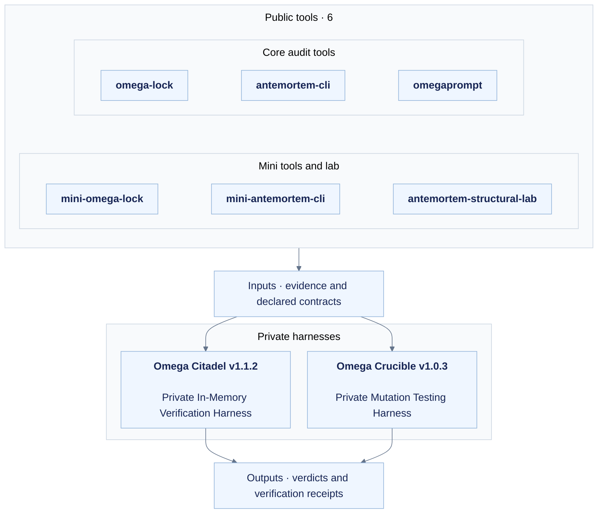

**English** | [한국어 (Korean)](./README.ko.md)

# AI Verification Research

Independent, non-commercial personal research and open-source software project for AI/ML evaluation and software reliability

The six public Python packages provide focused checks for code citations, evaluator noise, holdout overfitting, and software reliability.

[Current six-tool releases, contracts and keyless reproducers](#public-releases-and-checkpoints) are listed below; earlier audit records retain their original versions.

Two private integration & fault-injection research harnesses (non-commercial personal R&D)

The private harnesses use the public packages' declared contracts to measure in-memory integration overhead in a single process and test tolerance to synthetic mutations:

- **Omega Citadel · JEV Suite 1.1.2** combines grounding, statistical gates, holdout controls, and integrity receipts.
- **Omega Crucible · Red-Team Gauntlet 1.0.3** applies bounded synthetic mutations and cross-suite tests to explicit defender APIs.

Each result below is tied to its recorded version and test contract. The separately identified execution audit reran regression, protocol, mutation, and architecture checks without changing the code under evaluation. This page publishes contract boundaries, result summaries, and hashes. Citadel and Crucible source code, wheels, bundles, and original receipts remain private.

## Repository Access & Licensing (Non-Commercial Personal Research)

| Scope | Repositories or packages | License | Visibility |
|---|---|---|---|
| Public open-source packages | `omega-lock`, `antemortem-cli`, `omegaprompt`, `mini-omega-lock`, `mini-antemortem-cli`, `antemortem-structural-lab` | `Apache-2.0` | PUBLIC |
| Private research harnesses (non-commercial) | Omega Citadel; Omega Crucible | `All Rights Reserved — Personal R&D, No Redistribution` | PRIVATE |

The private harnesses require prior written authorization for access, copying, modification, redistribution, sublicensing, use, reverse engineering, decompilation, disassembly, structural replication with prompts or LLMs, and derivative works. These restrictions apply to the owner's material. Third-party components retain their own licenses, and the six public repositories remain Apache-2.0.

### Latest private research patches (v1.1.2 / v1.0.3)

| Research harness | Package version / private tag | Current source commit | Direct regression result |
|---|---|---|---|
| Omega Citadel | `1.1.2` / `v1.1.2` | `331392028dbbf21c62c7eca9a25b7c950b6a7ec3` | 265 PASS / 0 FAIL / 0 ERROR / 0 SKIP |
| Omega Crucible | `1.0.3` / `v1.0.3` | `29c87a253e1d416b5711654aee7fef91ca706964` | 355 PASS / 0 FAIL / 0 ERROR / 0 SKIP |

These patches update the personal, non-commercial research statement, owner notices, documentation, and package metadata. In the documented comparison, Citadel's 21 runtime modules retain the same execution AST. Its 5 embedded Python files, LICENSE, and NOTICE are byte-identical: 7 files in total. Crucible retains the execution AST in 13 package files and 9 test files. The comparison excludes docstrings and the documented display strings for versions, notices, and interface descriptions. Regression tests support this bounded check; it is not a proof of equivalence for every input.

Actual MCP 1.30.0 stdio checks passed initialization, tool discovery, and all 5 Citadel tool calls. Crucible passed all 6 calls through both the SDK and native backends. The standard wheel, offline bundle, and source-free locked runtime also passed checks in separate clean environments. The locked archives contain no plaintext package `.py` files, but bytecode can still be decompiled.

These wording and metadata patches establish no improvement in performance, generalization to new mutations, or OOS results. The latency and mutation records below keep their original versions and workloads. The repeated 265/355 regression counts are excluded from the historical cumulative total. Earlier tags, files, hashes, and failure receipts are preserved. Both harnesses remain PRIVATE with the `Private :: Do Not Upload` classifier. Research status remains `M0_HOLD / Utility & OOS NOT_ESTABLISHED`.

All **37/37** private release attachments were downloaded with authentication and matched their full-file SHA-256 hashes. The source blobs and tag targets matched the commits above, and both repositories remained PRIVATE. The publication readback receipt has full-file SHA-256 `6bc3b5a763f2b3b2c14a71ff7036481b499bc3905ca56168a3ef02d4b04ced71`.

#### Patch file hashes (v1.1.2 / v1.0.3)

These SHA-256 hashes cover the complete private patch files. They are integrity identifiers for authorized holders, not public download links. Each checksum manifest's own hash is listed separately from the file entries it contains.

| New private patch artifact | SHA-256 |
|---|---|
| `Citadel 1.1.2 / bundle-build.json` | `43b3aa8f5cbe546d611e6f1e943f9531305e5c5df660ad79c5ae76fbd15406ef` |
| `Citadel 1.1.2 / BUNDLE_VERIFICATION_v1.1.2.json` | `8dfab062565b65efe9671ae788a2fbe00470e9ac56c37e90e571f307aa8f5714` |
| `Citadel 1.1.2 / CHANGELOG.md` | `0be4721f83cb826dce053387a34dafec1a02f31ca791b4c49425915a10cff13f` |
| `Citadel 1.1.2 / COMPLIANCE_VERIFICATION_v1.1.2.json` | `fbc998bddac3c1695bdba7cf7e0ee4d121da37d553d42f72833cba405ef8651d` |
| `Citadel 1.1.2 / KEYWORD_SCAN_v1.1.2.json` | `cd2724d32b1a4e77ee6189d08b917f12b4194dde81c6605136f6d535a37cb0d7` |
| `Citadel 1.1.2 / LICENSE` | `bfdb27a203147789fcfac11a444c2bc8908e9f002291c51ed26b9dc1af229895` |
| `Citadel 1.1.2 / NOTICE` | `e1569cedab4c0e22fb6a4497713d484d54ba1ecbbb7dbff73dfdc7d230e536cf` |
| `Citadel 1.1.2 / omega-citadel-1.1.2-locked-runtime.zip` | `2604f342a2d375a4fd643cd510853524a534587a750d127edf8431f52849174f` |
| `Citadel 1.1.2 / omega-citadel-1.1.2-validation-evidence.zip` | `f3390e9b4e961e5e21520ee3af1b790768625aebb8e800bc946f435f1269b42f` |
| `Citadel 1.1.2 / omega-citadel-1.1.2-windows-py312.zip` | `2aa49da5c4ccac77f2fc1c0611d5f9e531ce2766dd62a5c8ed74434e34113811` |
| `Citadel 1.1.2 / omega_citadel-1.1.2-py3-none-any.whl` | `79e59e88f69d0f976ff48be42a0a0417c20f2aac95a41d9a075c2d3825a0b8fb` |
| `Citadel 1.1.2 / omega_citadel-1.1.2.tar.gz` | `fbf374e0ea9f8888bc00c64bf57fb13062ee57908df68150c7a2ccddc4ac45bc` |
| `Citadel 1.1.2 / pyproject.toml` | `3963b6d861eb462dbb2aaa330edc64198e7094e75bbbc65afb4e0c11817f15af` |
| `Citadel 1.1.2 / pytest-v1.1.2.log` | `2bbc04ec7c3790cce314c87e3dbcbdceff95ce4d5c540784aa64dd67406e11e3` |
| `Citadel 1.1.2 / pytest-v1.1.2.xml` | `86ac6809f6a882879538e0ca9c5888469ebf6e92bf9c6b817a24088f7f5f0b9b` |
| `Citadel 1.1.2 / README.ko.md` | `a798d0769b627339cc28776327c815e2c8f563ddb4f2bcd8dfb7fd8172475131` |
| `Citadel 1.1.2 / README.md` | `3442fdfacf0917b2b51c89283ff626f84888fd1c2e3bae9a0530a7d3ffa61eaa` |
| `Citadel 1.1.2 / RUNTIME_LOGIC_PRESERVATION.json` | `90940b4001544027dd6a9e7b46df70cb1ceb1c00fb2867f6bd32054be64cff2c` |
| `Citadel 1.1.2 / SHA256SUMS.json` | `1ca01d415720ac119d4619e872fbe8cfbb30baa5f1454fa378e50fd573b35f3c` |
| `Citadel 1.1.2 / SOURCE_BASELINE.json` | `90acba7ca68e76c65e37f73cc05c6f583fbd2a8290338c26bfc6afbd8c62766a` |
| `Crucible 1.0.3 / ARTIFACT_KEYWORD_SCAN.json` | `688f8aba6347fb4ed3e92178f6db95096752d33be4da1c41f9286e419fed14ea` |
| `Crucible 1.0.3 / BEHAVIOR_PRESERVATION.json` | `0478302a56cfb241f49896ebd7e84ecd3db966792214a5b88b4a7c04db6aba1c` |
| `Crucible 1.0.3 / CLEAN_WHEEL_VERIFICATION.json` | `9e545aa44c2737db78d91493f887fdd6e5569922422664a6b2745d43e53bf556` |
| `Crucible 1.0.3 / COMPLIANCE_VERIFICATION.json` | `1b99d47e0cb02efc96485823dfb876351c04c12eb21407dc8cc9b2371c31670e` |
| `Crucible 1.0.3 / KEYWORD_SCAN.json` | `a49cc245b1d00c41c080d2ac83259afda5669bdaa1beb4aa33e78bec926dca31` |
| `Crucible 1.0.3 / LICENSE` | `4cc2fd1d3235a694bd2d4e220e38cb148fde5c864020d0398e3a6482d93b6892` |
| `Crucible 1.0.3 / LOCKED_RUNTIME_VERIFICATION.json` | `aeb1f11f6ee802ab36f8bfd7ad45f273f5101d265f7dba5af7031583407ddbab` |
| `Crucible 1.0.3 / MCP_130_VERIFICATION.json` | `4ad4035121015a7891a312fe4e136ebdae28297bfa8ad45a538af617539e6f88` |
| `Crucible 1.0.3 / OFFLINE_INSTALL_VERIFICATION.json` | `639513a8848c63d443f6b2c77865264bb06c246992a7cf91af120cf5f5d378a1` |
| `Crucible 1.0.3 / omega-crucible-1.0.3-locked-runtime.zip` | `1f5282884bd2316e5cfa4a8733ed417d395c5ea71c60fc20ab70fec735b7cc34` |
| `Crucible 1.0.3 / omega-crucible-1.0.3-validation-evidence.zip` | `4f1ccd053c061c849c0177bc6a6a1cbc440a11489920da6c4e07106b7fd85be6` |
| `Crucible 1.0.3 / omega-crucible-1.0.3-windows-py312.zip` | `ffe45c5dca3ae810376db787731ebd0e7c747a297bca434a7a7b978d3ba49390` |
| `Crucible 1.0.3 / omega_crucible-1.0.3-py3-none-any.whl` | `9b159fe454f591a0a5459a7c48a30570ebe4b2a2f7d7c1ca52090a0b9345bc82` |
| `Crucible 1.0.3 / pytest-v1.0.3.xml` | `17b247b2caff69190c1c78689fdcb0b13420d7847b8eb4bf84a75f2e78c50757` |
| `Crucible 1.0.3 / README.ko.md` | `22297cf315ff952b78ece609588edb33d98506b19320c1208d29fab0c24977eb` |
| `Crucible 1.0.3 / README.md` | `44153f2012d51d0fafef31d20a1e2079a3784f2f69a3dba2b4e3fe6482d0fea3` |
| `Crucible 1.0.3 / SHA256SUMS.json` | `87a0a9e7c02add535182fd785dd32851a12a3d761f63c412ede319ca4b10887b` |

### Earlier packaging snapshots (v1.1.1 / v1.0.2)

The following records predate the latest wording and metadata patches. Their corpus, benchmark, control, and regression results remain tied to the versions shown.

| Research harness | Package version | Evaluated release code snapshot | Pytest result |
|---|---|---|---|
| Omega Citadel | `1.1.1` | `794ba06813cde28f95107013c320c1850052afa9` | 265 PASS / 0 FAIL / 0 ERROR / 0 SKIP |
| Omega Crucible | `1.0.2` | `aab3fb1d95ce8efc0a2be4f254895d09d3793fb6` | 355 PASS / 0 FAIL / 0 ERROR / 0 SKIP |

| Retained private artifact | SHA-256 |
|---|---|
| `omega-crucible / omega_crucible-1.0.2-py3-none-any.whl` | `2d84f08bb236c2b1ea9bb3373bee4c7a67b820312b4493f6f526a32870edbf74` |
| `omega-crucible / omega-crucible-1.0.2-windows-py312.zip` | `6c631498aa7bf598f84ef3260f96cf3bfb9a9365f7581f25bf944b72921282b8` |
| `omega-crucible / omega-crucible-1.0.2-locked-runtime.zip` | `fb19ca7ad88d9223a47028035403980640c4e11add9afa30f21a1073a13cacdc` |
| `omega-crucible / verification-report-v1.0.2.json` | `710e517fdca5f9d9f57e21f40a4e3986ac791bb4fbbe267ae5c84b8544489b99` |
| `omega-crucible / OMEGA_CRUCIBLE_REPORT_v1.0.2.html` | `e89eed995c26f99b447fb6490023e27411b9c88cd8a5ed2f6ec2cc671fdc1c07` |
| `omega-crucible / CrucibleGauntletReceipt-v1.0.2.json` | `57266581d55d852b7ef4877bc7c3aaca74e2479f4240f9bec29967e43d3dbccc` |
| `omega-crucible / installer-verification-v1.0.2.json` | `b119640273fbdf142d66ca518add5af314831f222f6049404a29bad84d87355f` |
| `omega-crucible / release-assets-v1.0.2.json` | `3bdeae3498b09eef131b92ac380b6a4ca2f19405a1343c7d68a00a7d8472ccd3` |
| `omega-crucible / FINAL_SHA256SUMS_v1.0.2.txt` | `8cf5a94b19f7a3bb61c6fb2dde1b219aaee8575e5d256bfc9bf27553053a309e` |
| `omega-crucible / omega-crucible-1.0.2-validation-evidence.zip` | `5c91e59a90bdb00ae6d46e85386f76d5d596c88dc00e2c121fee1cdba6ea8a37` |
| `omega-citadel / omega_citadel-1.1.1-py3-none-any.whl` | `73dc391af4d61dd652f0ee37f1e7822bb8b6a22157e98b60cf7d4f4242cfdf91` |
| `omega-citadel / omega-citadel-1.1.1-windows-py312.zip` | `048b515061de399c0c430cfbbba4a4001a6b14bc3977df9a465540a08b169d2c` |
| `omega-citadel / omega-citadel-1.1.1-locked-runtime.zip` | `3e1244c945e74a7bd1ecfd96972ff449c841105efcd5f704f48e805670d3727d` |
| `omega-citadel / LICENSE_README_VERIFICATION.json` | `56097877382f1966c9c01a4a1506b64be61e6e5450132b3d01df97ae866de473` |
| `omega-citadel / OMEGA_CITADEL_V111_REPORT_KO.html` | `d1a3b3eb5f836f31074c32dc8a522a2603a489b494a528f37e42c9ece29efec1` |
| `omega-citadel / SHA256SUMS.json` | `297f12b410a3e91d089bb6d98b844daf6b549da4322dfbed89bb6daaf6e5d286` |
| `omega-citadel / omega-citadel-1.1.1-validation-evidence.zip` | `4283822c148c9cd50470a17dc8b4e0c634a77d77e2030a53ee4a9c9ccd2edd60` |

The source repositories and release attachments remain private. These hashes identify file bytes for authorized comparison; they do not provide access. The packaging work does not establish research utility, OOS generalization, or the effectiveness of restrictions on replication. Research status remains `M0_HOLD / NOT_ESTABLISHED`.

## Execution audit (2026-11-02)

This audit evaluated the released Citadel **1.1.1** code snapshot `794ba06813cde28f95107013c320c1850052afa9` and Crucible **1.0.2** code snapshot `aab3fb1d95ce8efc0a2be4f254895d09d3793fb6`. The documentation commits and additional audit files are recorded separately. Existing tags and release files were preserved; the audit did not reissue the historical 1.1.0/1.0.1 releases.

| Private repository | Retained documentation commit / `audit-20261102` tag | Evaluated runtime release commit |
|---|---|---|
| Omega Citadel | `a380e6cd3c75d0217d41b24fb46e5769b64d9b87` | `794ba06813cde28f95107013c320c1850052afa9` |
| Omega Crucible | `a5eb868b82d9be2170eab72c1279b6936a4da0e0` | `aab3fb1d95ce8efc0a2be4f254895d09d3793fb6` |

Those documentation commits changed LICENSE, the two READMEs, and the audit summary. They left runtime Python files and package versions unchanged. The owner notice was `Copyright (c) 2026 Kyunghoon Gwak (hibou04-ops). All Rights Reserved.`; existing release archives were not rewritten.

| Fresh execution or current readback | Observation | Boundary |
|---|---|---|
| Citadel 1.1.1 pytest | 265 PASS / 0 FAIL / 0 ERROR / 0 SKIP | New direct regression run; not added to the cumulative historical PASS total |
| Crucible 1.0.2 pytest | 355 PASS / 0 FAIL / 0 ERROR / 0 SKIP | New direct regression run; not added to the cumulative historical PASS total |
| Actual MCP 1.30.0 stdio | Citadel: initialize, list 5 tools, call all 5; Crucible: initialize, list 6 tools, call all 6 through both SDK and native backends | Actual MCP request/response exchanges; SDK 2.x simulation remains separate; no MCP latency claim |
| Current external pipeline, fixed 1,067 attacks | Raw: 1,008 decision blocks, 1 survivor, 58 input rejections, 0 errors; controls 90/90 accepted | Frozen projection: 918 projected blocks, 91 unsupported, 58 input rejections; unsupported inputs are not established support |
| Current compound projection | 7/7 prevented: 3 decision blocks, 4 input rejections; control 1/1 accepted | Input rejection is not a semantic kill |
| Current native readback bridge | 512/512 integrity rejections; controls 2/2 accepted | Separate from pipeline decisions |
| Post-freeze seed D | Controls 64/64 accepted; attacks 544: 528 decision blocks, 16 input rejections, 0 survivors, 0 errors | Same-session randomized evaluation; same generator/specification, not independent external OOS |
| Seed D limitation probes | 32/32 survived: 16 self-consistent rehash envelopes and 16 unknown JSON shapes | Separate from the 544-attack denominator |
| New Crucible locked runtime | 13 package `.pyc`, 0 plaintext package `.py`, 17 manifest entries; clean-environment CLI, receipt readback and six native MCP calls passed | CPython 3.12 runtime; source omission does not prevent decompilation |
| Stage 5 current artifact readback | 2,160 PASS / 0 FAIL / 0 ERROR / 5 SKIP | Reparsed preserved original JUnit/log/closure files, not a new public-package test run |
| Structural Lab v8 current local readback | 1,561 PASS / 0 FAIL / 0 ERROR / 1 SKIP; 2,345 internal SHA-256 checks, 0 mismatches | Preserved JUnit and local archive; live Drive canonical documents were not rechecked |

The one raw survivor in the external corpus falls in the frozen adapter's unsupported bucket. The supplied payloads were checked for oracle roles, families, expected verdicts, and case labels; none were passed to the defender. This checks those payloads only. It does not establish that the generator or development corpus was previously unseen.

Seed C's first run recorded **640 ERROR** outcomes. Distribution metadata was present, but `.pth` initialization for editable installs had not run, so the helper imports failed. That failed run is preserved. The environment was corrected without changing defender source, then a fresh seed D was committed and evaluated against the same frozen source and generator. D does not replace C or establish independent OOS generalization. Earlier test-environment and harness-path failures are also preserved in the private audit receipts.

### Execution architecture benchmark (2026-11-02)

The benchmark used Windows x64, CPython 3.12.10, a fixed payload, and **20 alternating paired runs**. Gate outputs matched in **20/20** pairs:

| Measured scope | Cold five-subprocess harness | Warm in-memory pipeline |
|---|---:|---:|
| Median latency | 1,229.61405 ms | 19.3654 ms |
| Process spawns per iteration | 5 | 0 |
| Common-file AST parses per iteration | 5 | 1 |

The median latency ratio was **63.50×**, with 0 receipt readback mismatches. This compares execution architectures on one machine, not versions or the actual five public-package CLIs. The in-memory path starts with warm imports and includes input snapshots, receipt issuance, and readback, so startup conditions differ. Optional federated crosschecks were disabled on both sides to keep the vendored workload equal. The result establishes no improvement in model quality, research utility, other workloads, or OOS outcomes.

### Audit evidence hashes (2026-11-02)

These full-file SHA-256 hashes identify the private audit evidence. The files remain private, and the historical hashes below remain valid for their original records.

| Audit evidence file | SHA-256 |
|---|---|
| `Citadel fresh pytest XML` | `33774bfb10b73beda8fa8fd817c8d58657a0a47679587d4e5f908e6277c50713` |
| `Citadel fresh 20-run benchmark report` | `95b5bdb79a97029d0d74ef5a3e59b6a17914fa821a461c7c9f589515e952d157` |
| `Citadel seed C environment-failure report` | `e852dc8ef1df1823ef16d55db56cb14c8ba290ef58f07cfc7486d8bf99c05518` |
| `Citadel seed D randomized evaluation report` | `c72d22cf125d13357485a0e8e16306cb29a3c4854924810d4f6a8ccf43514ee1` |
| `Crucible fresh cross-suite and native verification` | `6deda0a1ac32feff0f64a810f43c4b9bcb89168fc73a58222eb930c90fe22690` |
| `Crucible actual MCP 1.30.0 stdio report` | `037e01c48c42199ff7642ecf45da8c5b23da0dba61270dc3213492570019bf53` |
| `Crucible new locked-runtime verification report` | `c42d40eae66d2a2b240626d01293ab28152841b5932cc8ed61ae6a608ce24842` |
| `Crucible new audit evidence ZIP` | `30caa0094a555ec20df237dc2d9074550329f2e7c8920f7bc10eb1f92bc43e73` |
| `Stage 5 preserved-artifact current readback` | `1775fd12606e8a2e7963686cd18c0b0b2ed5a759c538fb9f2c76a5d3b72490ef` |
| `Structural Lab v8 local-archive current readback` | `161b2999eab0b8f59b179affe2c2cf84f8b2c10a352c60646f17d30f651a8223` |

Package regression, file integrity, and bounded mutation results are separate findings. Research status remains **`M0_HOLD / Utility & OOS NOT_ESTABLISHED`**.

## Architecture and contract boundaries



| Boundary | Public contract |
|---|---|
| Input | Supplied evidence and explicit validation contracts |
| Private core | Internal implementation, dependencies, and execution order are not disclosed |
| Output | Contract-bound verdicts and integrity receipts; receipt readback verifies integrity |

AST attribution checks a citation's location, not the truth of a natural-language claim. There is no end-to-end `O(N)` guarantee. Statistical gates evaluate supplied samples and holdout assertions; independent experiments are still required.

## Validation records by version

**Recorded cumulative PASS count: 4,341 = 2,160 + 1,561 + 265 + 355.** The terms come from separate runs. The total does not count unique tests or independent cases, and it does not represent one run in a common environment.

| Ledger | Retained result | Evidence scope |
|---|---:|---|
| Five public tools · Stage 5 | 2,160 PASS / 0 FAIL / 0 ERROR / 5 SKIP | Verified Stage 5 artifacts: 627 + 592 + 616 + 157 + 168 |
| Structural Lab v8 | 1,561 PASS / 0 FAIL / 1 SKIP | Preserved original record; the skipped case is excluded from the PASS total |
| Citadel 1.1.0 | 265 PASS / 0 FAIL / 0 ERROR / 0 SKIP | Retained original direct pytest execution; separate from external mutation outcomes |
| Crucible 1.0.1 | 355 PASS / 0 FAIL / 0 ERROR / 0 SKIP | Retained original direct pytest execution; separate from external mutation outcomes |

The earlier **3,951** count was 2,160 + 1,561 + 230; **4,306** was 2,160 + 1,561 + 230 + 355. The 1.1.0 total replaces Citadel 1.0.1's 230 records with the 1.1.0 result. It does not add Crucible 1.0.0's earlier **316** PASS records again. Overlap between the test sets has not been independently established.

### Stage 5 records and separate public CI results

The 2,160 result is classified as `VERIFIED_STAGE5_ARTIFACTS`. A read-only comparison matched the **2026-11-01 23:10 KST** closing ledger, `release-closure.json`, five original JUnit files, and five pytest logs. The 2,165 tests comprise 2,160 PASS, 0 FAIL, 0 ERROR, and 5 SKIP. All 25 exit codes from pytest, consistency, build, twine, and release-audit were 0.

| Stage 5 source artifact | SHA-256 |
|---|---|
| `release-closure.json` | `7d200dbbbab8b564e3107bf83e5f81134f6a6ca534bfca8974f4a0bc98f95af6` |

Stage 5 recorded five public releases as PUBLISHED and compared their remote tag commits with the fixed snapshots below. Skips were omega-lock 3, antemortem-cli 1, omegaprompt 1, and 0 for each mini tool.

The separately observed **Ubuntu / Python 3.11 selected full-pytest jobs** covered a different execution scope:

| Public tool | Observed PASS | SKIP | Public CI evidence |
|---|---:|---:|---|
| omega-lock | 603 | 27 | [Selected job](https://github.com/hibou04-ops/omega-lock/actions/runs/41314509683/job/124871603846) |
| antemortem-cli | 593 | 0 | [Selected job](https://github.com/hibou04-ops/antemortem-cli/actions/runs/41314507040/job/124871596243) |
| omegaprompt | 616 | 0 | [Selected job](https://github.com/hibou04-ops/omegaprompt/actions/runs/41314509295/job/124871603311) |
| mini-omega-lock | 157 | 0 | [Selected job](https://github.com/hibou04-ops/mini-omega-lock/actions/runs/41314509674/job/124871604022) |
| mini-antemortem-cli | 168 | 0 | [Selected job](https://github.com/hibou04-ops/mini-antemortem-cli/actions/runs/41314509819/job/124871604481) |
| Selected-job total | **2,137** | **27** | Excludes other matrix jobs and subsequent demos |

The omega-lock count comes from its explicit summary. The other counts come from pass markers in completed logs for successful jobs. These CI results do not replace Stage 5's local result of 2,160 PASS / 5 SKIP. The v8 and Citadel records also remain separate.

## Public releases and checkpoints

### Current public releases and fail-closed contracts

Checked GitHub Latest Releases, tag-to-main commit identity, source metadata, current main Actions and version-specific PyPI files on 2026-11-03 (KST). Every Release tag below resolves to its linked main commit, whose checked main CI succeeded. Package metadata and PyPI publication are reported separately; the historical tables retain their original version-bound counts.

| Public tool | Latest GitHub Release | Package metadata | Current main CI | Architecture contract |
|---|---|---|---|---|
| [antemortem-cli](https://github.com/hibou04-ops/antemortem-cli) | [v0.12.3](https://github.com/hibou04-ops/antemortem-cli/releases/tag/v0.12.3) | [0.12.3](https://github.com/hibou04-ops/antemortem-cli/blob/17174e753d69759448d3a017edc27d5a2ab84610/pyproject.toml) · [PyPI files](https://pypi.org/project/antemortem/0.12.3/) | [SUCCESS](https://github.com/hibou04-ops/antemortem-cli/actions/runs/41467352658) · [main `17174e7`](https://github.com/hibou04-ops/antemortem-cli/tree/17174e753d69759448d3a017edc27d5a2ab84610) | Deterministic code-citation verifier and CI gate with `file:line` grounding and optional SHA-256 binding. Enforces `fabrication_rate` and total `effective_coverage` (`verified / total`), with a default coverage floor of 0.8. The `gate` recomputes citations from schema-validated classifications and current disk evidence, calls `compute_decision()`, and rejects stored/computed decision mismatches and insufficient evidence. `UNRESOLVED` denominator evasion and inconsistent stored approvals are blocked; recomputation is an integrity check, not source authentication. [Source: gate](https://github.com/hibou04-ops/antemortem-cli/blob/17174e753d69759448d3a017edc27d5a2ab84610/src/antemortem/commands/gate.py#L35) |
| [omega-lock](https://github.com/hibou04-ops/omega-lock) | [v0.3.12](https://github.com/hibou04-ops/omega-lock/releases/tag/v0.3.12) | [0.3.12](https://github.com/hibou04-ops/omega-lock/blob/2f68ce5c32cd6688d7e9829b3c7ea8e0486fc543/pyproject.toml) · [PyPI files](https://pypi.org/project/omega-lock/0.3.12/) | [SUCCESS](https://github.com/hibou04-ops/omega-lock/actions/runs/41467844485) · [main `2f68ce5`](https://github.com/hibou04-ops/omega-lock/tree/2f68ce5c32cd6688d7e9829b3c7ea8e0486fc543) | Fail-closed Optuna/ML holdout auditing. No-Holdout `SKIP` retains legacy `passed=True` with `holdout_evaluated=False` and `deployment_authorized=False`. Evaluated holdouts pair Pearson linear correlation with `max_degradation_gap` and default `max_relative_degradation=0.50`; `audit_optuna_study()` applies both degradation bounds to the mean and selected candidate. Relative degradation uses the original positive TRAIN mean and direction-adjusted gaps with `Fraction(str(value))`; exact `<= 0.50` comparisons accept the 50% boundary and prevent rounded displays masking excess. `UNDEFINED_NONPOSITIVE_TRAIN_BASELINE` keeps the absolute defense. The separate `compute_deflated_threshold()` helper adds caller-supplied noise/trial adjustment to a base threshold; these holdout gates do not automatically apply it. [Source: score_degradation](https://github.com/hibou04-ops/omega-lock/blob/2f68ce5c32cd6688d7e9829b3c7ea8e0486fc543/src/omega_lock/holdout_defense.py#L51) [Source: audit_optuna_study](https://github.com/hibou04-ops/omega-lock/blob/2f68ce5c32cd6688d7e9829b3c7ea8e0486fc543/src/omega_lock/integrations/optuna_bridge.py#L263) |
| [omegaprompt](https://github.com/hibou04-ops/omegaprompt) | [v2.2.5](https://github.com/hibou04-ops/omegaprompt/releases/tag/v2.2.5) | [2.2.5](https://github.com/hibou04-ops/omegaprompt/blob/80a272ea580f4eeb5f4bd6b6826ae35924bbef98/pyproject.toml) · [PyPI files](https://pypi.org/project/omegaprompt/2.2.5/) | [SUCCESS](https://github.com/hibou04-ops/omegaprompt/actions/runs/41468813891) · [main `80a272e`](https://github.com/hibou04-ops/omegaprompt/tree/80a272ea580f4eeb5f4bd6b6826ae35924bbef98) | Provider-neutral LLM evaluation and prompt calibration. `verify_calibration_preflight()` defaults noise to `None`: omitted/None inputs set `noise_floor_measured=False` and `PREFLIGHT_UNMEASURED_NOISE`. Explicit `0.0` sets `noise_floor_measured=True` but yields `PREFLIGHT_REJECTED`. Only finite supplied `observed_delta > noise_floor_mde > 0` with no blocking traps yields `PREFLIGHT_VALIDATED`. The measurement marker records a supplied-measurement assumption, not verified provenance. Every result keeps `holdout_verified=False` and `deployment_authorized=False`; the helper performs no independent OOS holdout experiment. [Source: verify_calibration_preflight](https://github.com/hibou04-ops/omegaprompt/blob/80a272ea580f4eeb5f4bd6b6826ae35924bbef98/src/omegaprompt/runtime.py#L72) |
| [mini-antemortem-cli](https://github.com/hibou04-ops/mini-antemortem-cli) | [v0.11.3](https://github.com/hibou04-ops/mini-antemortem-cli/releases/tag/v0.11.3) | [0.11.3](https://github.com/hibou04-ops/mini-antemortem-cli/blob/b0a731f9259f0d73d5976fb65091b738177dc2f3/pyproject.toml) · PyPI version not published · [history](https://pypi.org/project/mini-antemortem-cli/#history) | [SUCCESS](https://github.com/hibou04-ops/mini-antemortem-cli/actions/runs/41470153740) · [main `b0a731f`](https://github.com/hibou04-ops/mini-antemortem-cli/tree/b0a731f9259f0d73d5976fb65091b738177dc2f3) | Lightweight standalone static preflight linter for LLM evaluation configurations. Its 11 risk rules include train/test ID overlap, few-shot leakage and dead rubric weights. Dependency Inversion removes required `omegaprompt` installation; Pydantic remains the only direct required runtime dependency, with the optional `[bridge]` extra. Contract tests against `omegaprompt 2.2.5` check model/Enum/JSON round trips in both directions and matching validation-error types/locations; conversion remains explicit. [Source: to_omegaprompt_findings](https://github.com/hibou04-ops/mini-antemortem-cli/blob/b0a731f9259f0d73d5976fb65091b738177dc2f3/src/mini_antemortem_cli/bridge.py#L21) [Contract tests](https://github.com/hibou04-ops/mini-antemortem-cli/blob/b0a731f9259f0d73d5976fb65091b738177dc2f3/tests/test_bridge_contracts.py#L83) |
| [mini-omega-lock](https://github.com/hibou04-ops/mini-omega-lock) | [v0.8.5](https://github.com/hibou04-ops/mini-omega-lock/releases/tag/v0.8.5) | [0.8.5](https://github.com/hibou04-ops/mini-omega-lock/blob/7ceaf7ce9812b7138b99c4ce4fd1b2f95ca599b2/pyproject.toml) · [PyPI files](https://pypi.org/project/mini-omega-lock/0.8.5/) | [SUCCESS](https://github.com/hibou04-ops/mini-omega-lock/actions/runs/41472869057) · [main `7ceaf7c`](https://github.com/hibou04-ops/mini-omega-lock/tree/7ceaf7ce9812b7138b99c4ce4fd1b2f95ca599b2) | Lightweight standalone measurement-reliability analyzer. `compute_empirical_noise_ceiling()` defaults to `mean(abs(delta)) + 1.96 * pstdev(abs(delta)) / sqrt(n)`; population `pstdev` uses divisor `n`. `compute_minimum_detectable_effect()` remains an alias to the same callable, not a power-based MDE. Pydantic is the only direct required runtime dependency; `omegaprompt` is optional via `[bridge]`. Contract tests against `omegaprompt 2.2.5` check model/Enum/JSON seams in both directions, validation errors and explicit provider-error translation. Python schema classes retain a Python boundary. [Source: compute_empirical_noise_ceiling](https://github.com/hibou04-ops/mini-omega-lock/blob/7ceaf7ce9812b7138b99c4ce4fd1b2f95ca599b2/src/mini_omega_lock/probes.py#L482) [Source: adapt_omegaprompt_provider](https://github.com/hibou04-ops/mini-omega-lock/blob/7ceaf7ce9812b7138b99c4ce4fd1b2f95ca599b2/src/mini_omega_lock/bridge.py#L37) [Contract tests](https://github.com/hibou04-ops/mini-omega-lock/blob/7ceaf7ce9812b7138b99c4ce4fd1b2f95ca599b2/tests/test_bridge_contracts.py#L136) |
| [antemortem-structural-lab](https://github.com/hibou04-ops/antemortem-structural-lab) | [v0.8.2](https://github.com/hibou04-ops/antemortem-structural-lab/releases/tag/v0.8.2) | [0.8.2a1](https://github.com/hibou04-ops/antemortem-structural-lab/blob/467ae89987f319cdfba9ec09709c0bb52f21cddd/pyproject.toml) · PyPI version not published · [history](https://pypi.org/project/antemortem-structural-lab/#history) | [SUCCESS](https://github.com/hibou04-ops/antemortem-structural-lab/actions/runs/41467367486) · [main `467ae89`](https://github.com/hibou04-ops/antemortem-structural-lab/tree/467ae89987f319cdfba9ec09709c0bb52f21cddd) | Contract/oracle-driven counterexample research with property-based shrinking and metered C/D exploration. `epsilon_static_floor=0.50` reserves static policy C capacity. After both arms complete actual-call warmup, a phenotype comparison without unresolved uncertainty, zero D-only confirmed phenotype gain and strictly lower D yield can set `circuit_breaker_triggered=True` and return remaining D capacity to C. Unresolved D evidence stays `UNKNOWN`. Research ledger `M0 HOLD` (`M0_HOLD`) and utility/external OOS `NOT_ESTABLISHED` stay separate from engineering regressions. [Source: MixedPolicyScheduler](https://github.com/hibou04-ops/antemortem-structural-lab/blob/467ae89987f319cdfba9ec09709c0bb52f21cddd/tomolab/discovery/recursive_policy.py#L68) [Source: HardCallMeter.configure_policy_reservation](https://github.com/hibou04-ops/antemortem-structural-lab/blob/467ae89987f319cdfba9ec09709c0bb52f21cddd/tomolab/discovery/call_meter.py#L74) |

Structural Lab's `v0.8.2` is a research-ledger Release; `0.8.2a1` is its separate alpha package metadata. The static floor reserves nominal capacity rather than forcing expenditure after early termination. Its breaker also supports a conservative lower-bound branch when D has only PASS observations and C has a confirmed failure. Neither this scheduler nor CI success promotes the research/OOS verdict.

### Zero-API-Key 30-Second Reproducers

Run each command from its corresponding source checkout after installing its declared dependencies; omega-lock requires the `[p2]` extra (Optuna). These offline demos need no API key or model service. The 30-second label refers to the small demonstration, not dependency installation.

- [antemortem-cli demo](https://github.com/hibou04-ops/antemortem-cli/blob/17174e753d69759448d3a017edc27d5a2ab84610/examples/reproduce_citation_traps.py#L1): blocks `verified=1, fabricated=0, unresolved=9` (`fabrication_rate=0.0`, `effective_coverage=0.10`), a forged `SAFE_TO_PROCEED` decision and empty evidence; complete verified evidence passes. The script demonstrates evidence/decision traps, not code-hash tampering.
- [omega-lock demo](https://github.com/hibou04-ops/omega-lock/blob/2f68ce5c32cd6688d7e9829b3c7ea8e0486fc543/examples/reproduce_optuna_traps.py#L1): asserts four cases: No-Holdout `SKIP` with `deployment_authorized=False`; `TRAIN=[1,2,3]` / `TEST=[-100,-99,-98]` blocked despite Pearson `r=1.0` (`degradation_gap=101.0`); normalized `TRAIN=[0.7,0.8,0.9]` / `TEST=[0.01,0.02,0.03]` blocked at `relative_degradation=0.975` despite an absolute gap below 1.0; and a matching holdout pass.

```bash
python examples/reproduce_citation_traps.py
python examples/reproduce_optuna_traps.py
```

Both scripts assert the expected blocked/passing outcomes and exit successfully when those checks hold. `file:line`/optional SHA-256 citation validation is a separate verifier capability, not proof of claim truth or source authenticity.

### Historical public regression snapshots

| Public repository | Public release or checkpoint | Fixed regression snapshot commit | PASS snapshot |
|---|---|---|---:|
| [omega-lock](https://github.com/hibou04-ops/omega-lock) | [v0.3.10](https://github.com/hibou04-ops/omega-lock/releases/tag/v0.3.10) | `7e9736ad68cad4a201c39ecb14151978543c5741` | 627 |
| [antemortem-cli](https://github.com/hibou04-ops/antemortem-cli) | [v0.12.1](https://github.com/hibou04-ops/antemortem-cli/releases/tag/v0.12.1) | `8a47ad5b41e05879698ae46f84b783a8d4c0f496` | 592 |
| [omegaprompt](https://github.com/hibou04-ops/omegaprompt) | [v2.2.3](https://github.com/hibou04-ops/omegaprompt/releases/tag/v2.2.3) | `27e23788990a1ea951525a401a1cb6a880e83948` | 616 |
| [mini-omega-lock](https://github.com/hibou04-ops/mini-omega-lock) | [v0.8.2](https://github.com/hibou04-ops/mini-omega-lock/releases/tag/v0.8.2) | `e862019dcb1eedcad45a48f5c34ad7f6c09ba5ce` | 157 |
| [mini-antemortem-cli](https://github.com/hibou04-ops/mini-antemortem-cli) | [v0.11.1](https://github.com/hibou04-ops/mini-antemortem-cli/releases/tag/v0.11.1) | `5e1f0face5d4d7fdca1af8a6c6bb65451a211937` | 168 |
| [antemortem-structural-lab](https://github.com/hibou04-ops/antemortem-structural-lab) | [v0.8.0 / COMMITTED-v8](https://github.com/hibou04-ops/antemortem-structural-lab/releases/tag/v0.8.0) | `b23773c7d4cc1fb13dd7943964fdbee9afd8c7b0` | 1,561 |

Structural Lab's official GitHub release `v0.8.0 / COMMITTED-v8` points to the specified v8 commit. Publication does not promote the research verdict, and this tag does not change the package version. The earlier public package release [v0.8.0a1](https://github.com/hibou04-ops/antemortem-structural-lab/releases/tag/v0.8.0a1) remains a separate release at commit `3ece4df3bd01abe6aae58ef8a01bf4b01515f689`.

## Structural Lab v8: scope and limits

The v8 run is classified as `DEVELOPMENT_SYNTHETIC_EXPOSED`, with **0 independent OOS cases**. Its verdict remains `M0_HOLD / NOT_ESTABLISHED`. Package regression results establish neither research utility nor generalization beyond the tested scope.

Utility and OOS status: `NOT_ESTABLISHED`.

- Preserved local record: **1,561 PASS / 0 FAIL / 1 SKIP** (+32 PASS).
- Preserved remote record: **607 PASS / 0 FAIL / 0 SKIP** (+32 PASS) in each of four environments.
- Specified probe: **Target 192 / Oracle 192 / reset 384**, with strict 1:1 reset symmetry. External OCI: **0 / 0 / 0**; internal OCI control: `PASS`.
- The retained read-only recheck covered **2,345 internal SHA-256 hashes with 0 mismatches** across 13 canonical documents, both receipts, and the v5/v6/v7/v8 lineage.

Manifest: `OA-SYNC-20261101T230122+0900-572768 — COMMITTED v8`.

SHA-256: `df34bfbe7cb192819a1d1f181df8bcfce0218fc944f808febf25c648373289cb`.

The [original verification report](https://github.com/hibou04-ops/antemortem-structural-lab/releases/tag/v0.8.0) is attached to the official release.

## Citadel 1.1.0: recorded latency

The **Citadel 1.1.0 measurement on 2026-11-02** used Windows x64, CPython 3.12.10, the fixed harness payload, and **20 alternating paired runs**. Gate outputs were equivalent in all 20 pairs.

| Measured scope | Cold five-subprocess harness | Warm single-process in-memory pipeline |
|---|---:|---:|
| Recorded median latency | 1,176.35645 ms | 15.7332 ms |
| Process spawns per measured iteration | 5 | 0 |
| Common-file AST parses per iteration | 5 | 1 |

The recorded median latency ratio was **74.77×**. The in-memory measurement includes input snapshots, receipt issuance, and readback. It compares two execution architectures on one machine and a fixed payload; it establishes no version-to-version speed gain, model-quality improvement, research utility, or OOS result. The cold baseline runs equivalent gates in a five-stage harness, not the five public packages' actual CLIs. The in-memory path starts with warm imports, so startup conditions differ.

### Citadel 1.0.1: recorded latency

This recorded benchmark used **Windows x64, CPython 3.12.10, a fixed payload, and 20 alternating paired runs**. Gate decisions matched in all 20 pairs.

| Measured scope | Cold harness: five subprocess stages | Warm single process; in-memory AST index |
|---|---:|---:|
| Median latency | 1,122.6 ms | 14.2 ms |
| New processes spawned during measurement | 5 | 0 |
| AST parses of the common file | 5 | 1 |

The **median latency ratio was 79.1×**. The in-memory path included input snapshots, receipt issuance, and readback.

The cold baseline split the same gates across five subprocess stages. It did **not** execute the five public tools' actual CLIs. The other path used an in-memory AST index in a warm process, so startup conditions differed. These historical measurements describe that machine, payload, and execution structure. They establish no result for other workloads, model quality, statistical utility, or OOS outcomes, and were not rerun for this update.

## Citadel 1.1.0: file hashes

Version **1.1.0**; private validation snapshot commit: `c22b2c95c94a3db3772aba068ec4a11b8c4621b2`.

| Private artifact or receipt | SHA-256 |
|---|---|
| `omega_citadel-1.1.0-py3-none-any.whl` | `14508446f0edd7fcd7102edf18f29e9d017641e79340ce9dcaf66043ab7a0260` |
| `omega-citadel-1.1.0-windows-py312.zip` | `9a590291c683a841310e803015ba7c3b7e58b07319b990f1223684b4ddf4ad68` |
| `omega-citadel-1.1.0-locked-runtime.zip` | `f97040370d772633229d2b0a74dae1d6ed9ba8200275168993c37c4998c3671c` |
| `omega-citadel-1.1.0-validation-evidence.zip` | `76042d9597af914c3ff5bfe3f40d7dfa224ce8fbfc3a73e36fe997e66af05b03` |
| `OMEGA_CITADEL_V110_REPORT_KO.html` | `f64cc56135986590d81421047d1f173ce3d5db475cba527e23ccb2587a24fcff` |
| Final pytest XML | `971ab5566b8f48ce051b8e5a4979ea0899574e66bffcfc78564a2d2e04026a5e` |
| Full-file 20-run benchmark report | `ac06f886441cfcbeee92eb24798552530640f623cffe444a51c41c96e2af1a49` |
| Full-file original-corpus cross-validation report | `e23a2441525579190b3e8fd767c9dd89dbea39fd242eb1aafdefa7baa89b7923` |
| Full-file preserved seed A report | `54653e1dd9907f814758012c7e1e678c540ec74aaaf6468f592ebdd3f575b566` |
| Full-file fresh seed B report | `bb12459218885ea95eba1287718111544e660199c6030bcb943da03bcb57c03f` |
| Canonical execution-source inventory SHA-256 | `0bd154a6be7cac8dcff776124f397e335b6f8a64c47fdab2c655be476db912e5` |

The evaluated source was compared byte for byte with the commit blobs and the standard wheel. The wheel and offline bundle remain private. The locked runtime contains CPython 3.12 bytecode and a hash manifest, with no plaintext package `.py` files. Source omission does not prevent decompilation or independent reimplementation, and it does not authenticate the author. The hashes identify the files or the stated canonical inventory; they are not download links.

### Citadel 1.0.1: file hashes

Version **1.0.1**; private validation snapshot commit: `4ad4b62a22b9738973badd5f8fe538984cf1977f`.

The comparison record contains **1,495 hash checks with 0 mismatches**:

| Comparison | Count | Scope |
|---|---:|---|
| Git blob SHA-1 | 477 | Source files compared with Git object identifiers |
| SHA-256 | 1,018 | Source 477 + snapshot 89 + CI ZIP 5 + runtime 444 + binding 3 |

These totals include repeated checks of the same files. They do not count unique files or independent cases.

| Private artifact or receipt | SHA-256 |
|---|---|
| Wheel | `b0fcbaf0fb41a4a7f6d04c267cdf48f56d87c36a602c597817165bf937c8a40c` |
| Windows bundle ZIP | `58b720e2f210a3f63e6ea3827b698505950977bd1a24b7085ce3f46c9209f06c` |
| Canonical digest of the 20-run benchmark receipt | `8a5b18148043faf9a1c7c45dd9db9c28210b6eeb0e0e0abec27967cc4427af05` |
| Full-file digest of that benchmark receipt | `60a62a62ba54214ededb4e800ed7b4fe22d78b2be98125ef2370fe86858c21df` |

The canonical digest excludes the receipt's own digest field. The full-file digest hashes a different byte sequence.

## Crucible: local and external checks

On its own defenders, Crucible 1.0.1 recorded **1,067/1,067 detections, a 100.0% mutation kill rate, and 90 accepted healthy controls** on a fixed, finite corpus. That percentage does not apply to the external defender.

The external checks called the actual APIs with bounded synthetic attacks. The original-corpus pipeline adapter represents only part of the source contracts. Hashing an opaque file does not validate the values it contains. Results for local defenders, external decisions, survivors, unsupported inputs, and errors are therefore reported separately.

### Citadel 1.1.0 cross-check

The final 1.1.0 candidate was evaluated through Crucible's fixed projection using the original **1,067-attack / 90-control** corpus. Raw engine outcomes are reported separately from the frozen adapter's mutually exclusive categories.

| Version | Attacks | Raw decision blocks | Raw survivors | Input rejections | Errors | Controls accepted |
|---|---:|---:|---:|---:|---:|---:|
| 1.0.1 · `4ad4b62` | 1,067 | 352 | 657 | 58 | 0 | 90 / 90 |
| 1.1.0 · `c22b2c9` | 1,067 | 1,008 | 1 | 58 | 0 | 90 / 90 |

For 1.1.0, the frozen adapter reports **918 projected decision blocks + 91 unsupported + 58 input rejections = 1,067**. The raw engine blocked 90 of those 91 unsupported cases and left one survivor. Those blocks do not establish support for every field in the original contracts. The fall in raw survivors from 657 to one was observed on a corpus exposed during development; it is not independent evidence of generalization. Input rejections are not semantic mutation kills.

| Post-freeze seed B evaluation | Count | Observed result |
|---|---:|---|
| Healthy controls | 64 | 64 accepted; 0 false positives |
| Valid-schema semantic contradictions | 368 | 368 decision blocks |
| Malformed schema/type/finite/count inputs | 176 | 160 decision blocks; 16 input rejections |
| Attack total | 544 | 528 decision blocks; 16 input rejections; 0 raw survivors and errors |
| Rehashed self-consistent envelope probes | 16 | 16 survivors |
| Unknown JSON-shape probes | 16 | 16 survivors |

The 32 probes are excluded from the 544-attack denominator. A consistent unkeyed envelope has no independently trusted author root, and an unknown JSON shape remains opaque. Their survival is a recorded limit.

**The failed candidates remain in the record.** Candidate A accepted only **42/90 original controls**; its first randomized seed A accepted **60/64 controls**. Both failed the zero-false-positive gate. The 16 AST attacks paired with seed A's four failed healthy controls cannot establish added defense value, because those healthy baselines already failed.

After A's results were exposed and general contract handling was corrected, the defender was frozen again. Seed B used **the same preserved generator and specification with a fresh secret random seed**. Inputs were generated and committed after that source freeze, before defender execution. The generator, payloads, seed, commitments, and raw outcomes are preserved; the defender received no role, family, oracle label, or expected verdict. B is a same-session test after correction, not an independently unseen external holdout. Its 64/64 controls do not erase A's failures. The original corpus, seed A, seed B, and probes are not combined into one success rate.

Research status remains **`M0_HOLD / Utility & OOS NOT_ESTABLISHED`**. These observations do not establish generalization, causal research utility, performance beyond the tested scope, or impossibility of replication.

### Citadel 1.0.1 pipeline results

| External contract | Attacks | Projected decision blocks | Survivors | Unsupported | Input rejections | Errors | Controls | Control result |
|---|---:|---:|---:|---:|---:|---:|---:|---|
| Citadel `4ad4b62` baseline projection | 1,067 | 352 | 566 | 91 | 58 | 0 | 90 | `PASS` |
| Citadel compound holdout | 7 | 3 | 0 | 0 | 4 | 0 | 1 | `PASS` |

| External contract | Preserved raw outcomes | Adapter coverage |
|---|---|---|
| Baseline projection | `ESTABLISHED` 657; `M0_HOLD` 64; `NOT_ESTABLISHED` 288; `REJECTED_INPUT` 58 | `PARTIAL` 976; `UNSUPPORTED` 91 |
| Compound holdout | `NOT_ESTABLISHED` 3; `REJECTED_INPUT` 4 | `SUPPORTED` 7 |

Both rows use `ACTUAL_CITADEL_PIPELINE_RAW_OUTCOMES_WITH_EXPLICIT_PARTIAL_ADAPTER_COVERAGE`.

**Raw survivors total 657 = 566 in the exclusive survivor bucket + 91 in the unsupported bucket.** The raw outcomes of unsupported cases remain visible. The mutually exclusive categories satisfy:

`attacks = projected decision blocks + survivors + unsupported + input rejections + errors`.

`REJECTED_INPUT`, including `ValueError` and missing-file rejection, is not a semantic mutation kill. Controls are excluded from the attack denominator. An attack marked `adapter_support=UNSUPPORTED` enters the unsupported category regardless of its raw outcome, which is preserved separately. All other outcomes enter exactly one category: error, input rejection, `BLOCKED_DECISION`, or `SURVIVED`.

`UNSUPPORTED` is not a pass. `SURVIVED` means the attack was not detected under the stated contract. Support is not assumed for missing input, signature, or declaration-start-line contracts. A policy conversion to `M0_HOLD` is distinct from a raw engine verdict such as `NOT_ESTABLISHED`; adapter rejection is distinct from an executed API decision. Results from different contracts or runs are not combined into one external kill rate. The record establishes neither 100% detection by every defender nor an overall cross-suite PASS.

### Separate native receipt checks

The bridge maps bit-flip positions into **Citadel's native receipt schema**; it does not submit the original Crucible receipt payloads. Its integrity rejections are separate from pipeline decision blocks and `ValueError` input rejections.

| Native contract | Attacks | Integrity rejections | Survivors / unsupported / errors | Controls | Control result | Raw result |
|---|---:|---:|---|---:|---|---|
| Citadel native readback bridge | 512 | 512 | 0 / 0 / 0 | 2 | `PASS` | `INVALID_RECEIPT` 512 |

The additional holdout fixed its seven attacks and one control before defender execution **within the same session**. Those results and the native bridge's 512 attacks and two controls are reported separately from the original corpus. This precommit does not establish an independently unseen external holdout, remove development exposure, or rule out circular validation.

Local corpus results apply to the stated version and contract. They establish no generalization to new attacks, protection rate across other auditors, research utility, performance beyond the tested scope, or SOTA superiority. An MCP 2.x mock contract does not certify compatibility with the actual SDK 2.x.

### Crucible 1.0.1: file hashes

| Identifier | Value |
|---|---|
| Source commit | `e7ccf019bf5a4f40d8d363dc468656060df32901` |
| Wheel filename | `omega_crucible-1.0.1-py3-none-any.whl` |
| Wheel SHA-256 | `97783cfceaa576a68c03b7b9f1798d4ae8b146f076c70db66dae68a7ad1a5678` |
| Gauntlet receipt canonical-body SHA-256 | `f98dc0a415f32cf4801fd4b98af412604a00ed20abdc7119a7093a3b8e919692` |
| Full-file SHA-256 of that receipt | `1be5e3580d7f17d56135850436c95d066ab933e805d65eeb958737126e75b879` |
| Final pytest XML SHA-256 | `45353f673e45f1f04c636cc5c2f04f89b39155bb7a901aa3a19b1eaee63160fe` |

## What the hashes verify

The hashes let authorized holders compare their private originals. They do not make source code, distributions, receipts, or private commits publicly accessible.

A hash does not establish legal ownership, notarization, a trusted creation time, or author identity. JEV integrity receipts and SHA-256 hashes are not authenticated electronic signatures or Sigstore/SLSA certification. Keeping files private does not eliminate replication risk.

## Private audit release hashes

The two `audit-20261102` releases preserve the original versioned wheels and runtime source commits. All 30 attachments were downloaded again with authentication, and every full-file SHA-256 hash matched. The manifests list the additional audit files; archive contents and original receipts remain private.

| Artifact | SHA-256 |
|---|---|
| `citadel-v1.1.1-audit / omega-citadel-1.1.1-fresh-validation-evidence.zip` | `027a737934f8c113125ff5b28fe1302031ebc071655bbee15629f36f48b6300f` |
| `citadel-v1.1.1-audit / AUDIT_RELEASE_SHA256SUMS.json` | `73489cc5c46e22601afec017851a95c6ca271bafd895702824ed0304c72a0df5` |
| `crucible-v1.0.2-audit / omega-crucible-1.0.2-fresh-validation-evidence.zip` | `30caa0094a555ec20df237dc2d9074550329f2e7c8920f7bc10eb1f92bc43e73` |
| `crucible-v1.0.2-audit / AUDIT_RELEASE_SHA256SUMS.json` | `9f58b0f4b2661868a0bba1c6595cd82c5f952d0b7b4a9905a5fe10db1fff247b` |

Copyright (c) 2026 Kyunghoon Gwak (hibou04-ops). Independent, non-commercial personal research. All Rights Reserved on private repositories.
